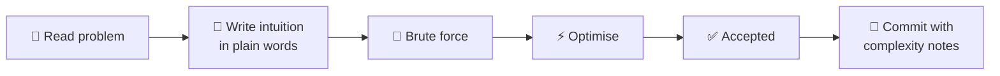

<div align="center">


<p>


</p>

<!-- 📊 PROGRESS: update these three numbers as you solve -->
<p>


</p>

**[📚 Solutions](#-solutions)** · **[🗂️ By topic](#%EF%B8%8F-by-topic)** · **[🧠 How I write solutions](#-how-i-write-each-solution)** · **[🎯 Goals](#-goals)**

</div>

---

## 📈 Live LeetCode stats

<div align="center">

<!-- Replace LEETCODE_USERNAME (2 places) with your LeetCode username -->


<a href="https://leetcode.com/u/LEETCODE_USERNAME/"></a>

</div>

## 💡 About this repo

I'm learning data structures and algorithms in **Java**, starting from zero and working towards hard problems. Every solution here is written to be **understood**, not just accepted:

- 🧠 **Intuition first:** the idea in plain words before any code
- 🪜 **Step-by-step approach:** how to get from brute force to optimal
- ⏱️ **Complexity:** time and space for every solution
- 💬 **Commented code:** readable months later, by anyone

## 📚 Solutions

<!-- Add one row per problem. Difficulty badges: 🟢 Easy · 🟡 Medium · 🔴 Hard -->

| # | Problem | Difficulty | Topic | Solution | Time | Space |
|:-:|---|:-:|---|:-:|:-:|:-:|
| 700 | [Search in a Binary Search Tree](https://leetcode.com/problems/search-in-a-binary-search-tree/) | 🟢 Easy | BST | [Java](./trees/0700-search-in-a-bst/Solution.java) | `O(h)` | `O(1)` |
| — | *next problem goes here* | | | | | |

> ✍️ **The row above is an example.** Replace it with the first problem you actually solve, and add a row each time you push a new solution.

## 🗂️ By topic

<table>
<tr>
<td align="center" width="25%">🌳<br/><b>Trees & BST</b><br/><sub><code>/trees</code></sub><br/></td>
<td align="center" width="25%">🔢<br/><b>Arrays & Hashing</b><br/><sub><code>/arrays</code></sub><br/></td>
<td align="center" width="25%">👉👈<br/><b>Two Pointers</b><br/><sub><code>/two-pointers</code></sub><br/></td>
<td align="center" width="25%">🔗<br/><b>Linked Lists</b><br/><sub><code>/linked-lists</code></sub><br/></td>
</tr>
<tr>
<td align="center">📚<br/><b>Stacks & Queues</b><br/><sub><code>/stacks</code></sub><br/></td>
<td align="center">🔍<br/><b>Binary Search</b><br/><sub><code>/binary-search</code></sub><br/></td>
<td align="center">🕸️<br/><b>Graphs</b><br/><sub><code>/graphs</code></sub><br/></td>
<td align="center">🧮<br/><b>Dynamic Programming</b><br/><sub><code>/dp</code></sub><br/></td>
</tr>
</table>

## 🧠 How I write each solution

Every problem gets its own folder with a `Solution.java` and a short `README.md`:

```
trees/
└── 0700-search-in-a-bst/
    ├── Solution.java
    └── README.md      ← intuition, approach, complexity
```

```java
/**
 * 700. Search in a Binary Search Tree  (Easy)
 * https://leetcode.com/problems/search-in-a-binary-search-tree/
 *
 * Intuition: in a BST, smaller values are always on the left and bigger ones
 *            on the right, so at each node we only need to go ONE way.
 * Time:  O(h)  where h = height of the tree
 * Space: O(1)  iterative, no recursion stack
 */
class Solution {
    public TreeNode searchBST(TreeNode root, int val) {
        while (root != null && root.val != val) {
            root = (val < root.val) ? root.left : root.right;   // go one way only
        }
        return root;   // the node, or null if not found
    }
}
```



## 🎯 Goals

- [ ] 🌳 Finish the core BST problems (search, insert, delete, validate, k-th smallest)
- [ ] 🧩 Solve **[1569. Number of Ways to Reorder Array to Get Same BST](https://leetcode.com/problems/number-of-ways-to-reorder-array-to-get-same-bst/)** (Hard)
- [ ] 💯 Reach 100 problems solved
- [ ] 🔥 Keep a 30-day streak
- [ ] 📚 Cover all 8 topics above

## 🧰 Tools

<p align="center"></p>

---

<div align="center">

**[Hemashree V I](https://hemashreevi.github.io)** · B.Tech CSE (Cyber Physical Systems), VIT Chennai

<a href="https://hemashreevi.github.io"></a>
<a href="https://www.linkedin.com/in/hema-shree-373622289"></a>
<a href="https://leetcode.com/u/LEETCODE_USERNAME/"></a>

<sub>⭐ Star this repo if a solution helped you understand a problem.</sub>

</div>
