<div align="center">




<p>


</p>

<p>


</p>

**[📚 Solutions](#-solutions)** · **[🗂️ By topic](#%EF%B8%8F-by-topic)** · **[🧠 How I write solutions](#-how-i-write-each-solution)** · **[🎯 Goals](#-goals)**

</div>

---

## 📈 Live LeetCode stats

<div align="center">

<!-- Replace hemashree_272005 (2 places) with your LeetCode username -->


<a href="https://leetcode.com/u/hemashree_272005/"></a>

</div>

## 💡 About this repo

I'm learning data structures and algorithms in **Java**, starting from zero and working towards hard problems. Every solution here is written to be **understood**, not just accepted:

- 🧠 **Intuition first:** the idea in plain words before any code
- 🪜 **Step-by-step approach:** how to get from brute force to optimal
- ⏱️ **Complexity:** time and space for every solution
- 💬 **Commented code:** readable months later, by anyone

## 📚 Solutions

Every row links to the code and to a 📖 write-up with the **intuition, step-by-step approach, flowchart, dry run and complexity**.

| # | Problem | Difficulty | Topic | Solution | Time | Space |
|:-:|---|:-:|---|:-:|:-:|:-:|
| 1 | [Two Sum](https://leetcode.com/problems/two-sum/) | 🟢 Easy | Arrays & Hashing | [Java](./arrays/0001-two-sum/Solution.java) · [📖](./arrays/0001-two-sum/README.md) | `O(n)` | `O(n)` |
| 4 | [Median of Two Sorted Arrays](https://leetcode.com/problems/median-of-two-sorted-arrays/) | 🔴 Hard | Binary Search | [Java](./binary-search/0004-median-of-two-sorted-arrays/Solution.java) · [📖](./binary-search/0004-median-of-two-sorted-arrays/README.md) | `O(log min(m,n))` | `O(1)` |
| 9 | [Palindrome Number](https://leetcode.com/problems/palindrome-number/) | 🟢 Easy | Math | [Java](./math/0009-palindrome-number/Solution.java) · [📖](./math/0009-palindrome-number/README.md) | `O(log n)` | `O(1)` |
| 13 | [Roman to Integer](https://leetcode.com/problems/roman-to-integer/) | 🟢 Easy | Strings | [Java](./strings/0013-roman-to-integer/Solution.java) · [📖](./strings/0013-roman-to-integer/README.md) | `O(n)` | `O(1)` |
| 14 | [Longest Common Prefix](https://leetcode.com/problems/longest-common-prefix/) | 🟢 Easy | Strings | [Java](./strings/0014-longest-common-prefix/Solution.java) · [📖](./strings/0014-longest-common-prefix/README.md) | `O(S)` | `O(1)` |
| 17 | [Letter Combinations of a Phone Number](https://leetcode.com/problems/letter-combinations-of-a-phone-number/) | 🟡 Medium | Backtracking | [Java](./backtracking/0017-letter-combinations-of-a-phone-number/Solution.java) · [📖](./backtracking/0017-letter-combinations-of-a-phone-number/README.md) | `O(4ⁿ·n)` | `O(n)` |
| 20 | [Valid Parentheses](https://leetcode.com/problems/valid-parentheses/) | 🟢 Easy | Stack | [Java](./stacks/0020-valid-parentheses/Solution.java) · [📖](./stacks/0020-valid-parentheses/README.md) | `O(n)` | `O(n)` |
| 21 | [Merge Two Sorted Lists](https://leetcode.com/problems/merge-two-sorted-lists/) | 🟢 Easy | Linked List | [Java](./linked-lists/0021-merge-two-sorted-lists/Solution.java) · [📖](./linked-lists/0021-merge-two-sorted-lists/README.md) | `O(m+n)` | `O(1)` |
| 22 | [Generate Parentheses](https://leetcode.com/problems/generate-parentheses/) | 🟡 Medium | Backtracking | [Java](./backtracking/0022-generate-parentheses/Solution.java) · [📖](./backtracking/0022-generate-parentheses/README.md) | `O(4ⁿ/√n)` | `O(n)` |
| 25 | [Reverse Nodes in k-Group](https://leetcode.com/problems/reverse-nodes-in-k-group/) | 🔴 Hard | Linked List | [Java](./linked-lists/0025-reverse-nodes-in-k-group/Solution.java) · [📖](./linked-lists/0025-reverse-nodes-in-k-group/README.md) | `O(n)` | `O(1)` |
| 26 | [Remove Duplicates from Sorted Array](https://leetcode.com/problems/remove-duplicates-from-sorted-array/) | 🟢 Easy | Two Pointers | [Java](./two-pointers/0026-remove-duplicates-from-sorted-array/Solution.java) · [📖](./two-pointers/0026-remove-duplicates-from-sorted-array/README.md) | `O(n)` | `O(1)` |
| 27 | [Remove Element](https://leetcode.com/problems/remove-element/) | 🟢 Easy | Two Pointers | [Java](./two-pointers/0027-remove-element/Solution.java) · [📖](./two-pointers/0027-remove-element/README.md) | `O(n)` | `O(1)` |
| 28 | [Find the Index of the First Occurrence in a String](https://leetcode.com/problems/find-the-index-of-the-first-occurrence-in-a-string/) | 🟢 Easy | Strings | [Java](./strings/0028-find-the-index-of-the-first-occurrence-in-a-string/Solution.java) · [📖](./strings/0028-find-the-index-of-the-first-occurrence-in-a-string/README.md) | `O(n·m)` | `O(1)` |
| 32 | [Longest Valid Parentheses](https://leetcode.com/problems/longest-valid-parentheses/) | 🔴 Hard | DP | [Java](./dp/0032-longest-valid-parentheses/Solution.java) · [📖](./dp/0032-longest-valid-parentheses/README.md) | `O(n)` | `O(n)` |
| 35 | [Search Insert Position](https://leetcode.com/problems/search-insert-position/) | 🟢 Easy | Binary Search | [Java](./binary-search/0035-search-insert-position/Solution.java) · [📖](./binary-search/0035-search-insert-position/README.md) | `O(log n)` | `O(1)` |
| 39 | [Combination Sum](https://leetcode.com/problems/combination-sum/) | 🟡 Medium | Backtracking | [Java](./backtracking/0039-combination-sum/Solution.java) · [📖](./backtracking/0039-combination-sum/README.md) | `exp.` | `O(T/M)` |
| 42 | [Trapping Rain Water](https://leetcode.com/problems/trapping-rain-water/) | 🔴 Hard | Two Pointers | [Java](./two-pointers/0042-trapping-rain-water/Solution.java) · [📖](./two-pointers/0042-trapping-rain-water/README.md) | `O(n)` | `O(1)` |
| 44 | [Wildcard Matching](https://leetcode.com/problems/wildcard-matching/) | 🔴 Hard | DP | [Java](./dp/0044-wildcard-matching/Solution.java) · [📖](./dp/0044-wildcard-matching/README.md) | `O(m·n)` | `O(m·n)` |
| 46 | [Permutations](https://leetcode.com/problems/permutations/) | 🟡 Medium | Backtracking | [Java](./backtracking/0046-permutations/Solution.java) · [📖](./backtracking/0046-permutations/README.md) | `O(n·n!)` | `O(n)` |
| 54 | [Spiral Matrix](https://leetcode.com/problems/spiral-matrix/) | 🟡 Medium | Matrix | [Java](./matrix/0054-spiral-matrix/Solution.java) · [📖](./matrix/0054-spiral-matrix/README.md) | `O(m·n)` | `O(1)` |
| 58 | [Length of Last Word](https://leetcode.com/problems/length-of-last-word/) | 🟢 Easy | Strings | [Java](./strings/0058-length-of-last-word/Solution.java) · [📖](./strings/0058-length-of-last-word/README.md) | `O(n)` | `O(1)` |
| 66 | [Plus One](https://leetcode.com/problems/plus-one/) | 🟢 Easy | Arrays | [Java](./arrays/0066-plus-one/Solution.java) · [📖](./arrays/0066-plus-one/README.md) | `O(n)` | `O(1)` |
| 70 | [Climbing Stairs](https://leetcode.com/problems/climbing-stairs/) | 🟢 Easy | DP | [Java](./dp/0070-climbing-stairs/Solution.java) · [📖](./dp/0070-climbing-stairs/README.md) | `O(n)` | `O(1)` |
| 73 | [Set Matrix Zeroes](https://leetcode.com/problems/set-matrix-zeroes/) | 🟡 Medium | Matrix | [Java](./matrix/0073-set-matrix-zeroes/Solution.java) · [📖](./matrix/0073-set-matrix-zeroes/README.md) | `O(m·n)` | `O(1)` |
| 88 | [Merge Sorted Array](https://leetcode.com/problems/merge-sorted-array/) | 🟢 Easy | Two Pointers | [Java](./two-pointers/0088-merge-sorted-array/Solution.java) · [📖](./two-pointers/0088-merge-sorted-array/README.md) | `O(m+n)` | `O(1)` |
| 103 | [Binary Tree Zigzag Level Order Traversal](https://leetcode.com/problems/binary-tree-zigzag-level-order-traversal/) | 🟡 Medium | Trees / BFS | [Java](./trees/0103-binary-tree-zigzag-level-order-traversal/Solution.java) · [📖](./trees/0103-binary-tree-zigzag-level-order-traversal/README.md) | `O(n)` | `O(w)` |
| 114 | [Flatten Binary Tree to Linked List](https://leetcode.com/problems/flatten-binary-tree-to-linked-list/) | 🟡 Medium | Trees | [Java](./trees/0114-flatten-binary-tree-to-linked-list/Solution.java) · [📖](./trees/0114-flatten-binary-tree-to-linked-list/README.md) | `O(n)` | `O(1)` |
| 118 | [Pascal's Triangle](https://leetcode.com/problems/pascals-triangle/) | 🟢 Easy | DP | [Java](./dp/0118-pascals-triangle/Solution.java) · [📖](./dp/0118-pascals-triangle/README.md) | `O(n²)` | `O(1)` |
| 121 | [Best Time to Buy and Sell Stock](https://leetcode.com/problems/best-time-to-buy-and-sell-stock/) | 🟢 Easy | Arrays / Greedy | [Java](./arrays/0121-best-time-to-buy-and-sell-stock/Solution.java) · [📖](./arrays/0121-best-time-to-buy-and-sell-stock/README.md) | `O(n)` | `O(1)` |
| 129 | [Sum Root to Leaf Numbers](https://leetcode.com/problems/sum-root-to-leaf-numbers/) | 🟡 Medium | Trees / DFS | [Java](./trees/0129-sum-root-to-leaf-numbers/Solution.java) · [📖](./trees/0129-sum-root-to-leaf-numbers/README.md) | `O(n)` | `O(h)` |
| 143 | [Reorder List](https://leetcode.com/problems/reorder-list/) | 🟡 Medium | Linked List | [Java](./linked-lists/0143-reorder-list/Solution.java) · [📖](./linked-lists/0143-reorder-list/README.md) | `O(n)` | `O(1)` |
| 150 | [Evaluate Reverse Polish Notation](https://leetcode.com/problems/evaluate-reverse-polish-notation/) | 🟡 Medium | Stack | [Java](./stacks/0150-evaluate-reverse-polish-notation/Solution.java) · [📖](./stacks/0150-evaluate-reverse-polish-notation/README.md) | `O(n)` | `O(n)` |
| 169 | [Majority Element](https://leetcode.com/problems/majority-element/) | 🟢 Easy | Arrays | [Java](./arrays/0169-majority-element/Solution.java) · [📖](./arrays/0169-majority-element/README.md) | `O(n)` | `O(1)` |
| 175 | [Combine Two Tables](https://leetcode.com/problems/combine-two-tables/) | 🟢 Easy | SQL | [SQL](./sql/0175-combine-two-tables/solution.sql) · [📖](./sql/0175-combine-two-tables/README.md) | – | – |
| 181 | [Employees Earning More Than Their Managers](https://leetcode.com/problems/employees-earning-more-than-their-managers/) | 🟢 Easy | SQL | [SQL](./sql/0181-employees-earning-more-than-their-managers/solution.sql) · [📖](./sql/0181-employees-earning-more-than-their-managers/README.md) | – | – |
| 182 | [Duplicate Emails](https://leetcode.com/problems/duplicate-emails/) | 🟢 Easy | SQL | [SQL](./sql/0182-duplicate-emails/solution.sql) · [📖](./sql/0182-duplicate-emails/README.md) | – | – |
| 183 | [Customers Who Never Order](https://leetcode.com/problems/customers-who-never-order/) | 🟢 Easy | SQL | [SQL](./sql/0183-customers-who-never-order/solution.sql) · [📖](./sql/0183-customers-who-never-order/README.md) | – | – |
| 184 | [Department Highest Salary](https://leetcode.com/problems/department-highest-salary/) | 🟡 Medium | SQL | [SQL](./sql/0184-department-highest-salary/solution.sql) · [📖](./sql/0184-department-highest-salary/README.md) | – | – |
| 196 | [Delete Duplicate Emails](https://leetcode.com/problems/delete-duplicate-emails/) | 🟢 Easy | SQL | [SQL](./sql/0196-delete-duplicate-emails/solution.sql) · [📖](./sql/0196-delete-duplicate-emails/README.md) | – | – |
| 198 | [House Robber](https://leetcode.com/problems/house-robber/) | 🟡 Medium | DP | [Java](./dp/0198-house-robber/Solution.java) · [📖](./dp/0198-house-robber/README.md) | `O(n)` | `O(1)` |
| 199 | [Binary Tree Right Side View](https://leetcode.com/problems/binary-tree-right-side-view/) | 🟡 Medium | Trees / DFS | [Java](./trees/0199-binary-tree-right-side-view/Solution.java) · [📖](./trees/0199-binary-tree-right-side-view/README.md) | `O(n)` | `O(h)` |
| 204 | [Count Primes](https://leetcode.com/problems/count-primes/) | 🟡 Medium | Math | [Java](./math/0204-count-primes/Solution.java) · [📖](./math/0204-count-primes/README.md) | `O(n log log n)` | `O(n)` |
| 215 | [Kth Largest Element in an Array](https://leetcode.com/problems/kth-largest-element-in-an-array/) | 🟡 Medium | Heap | [Java](./arrays/0215-kth-largest-element-in-an-array/Solution.java) · [📖](./arrays/0215-kth-largest-element-in-an-array/README.md) | `O(n log k)` | `O(k)` |
| 224 | [Basic Calculator](https://leetcode.com/problems/basic-calculator/) | 🔴 Hard | Stack | [Java](./stacks/0224-basic-calculator/Solution.java) · [📖](./stacks/0224-basic-calculator/README.md) | `O(n)` | `O(n)` |
| 322 | [Coin Change](https://leetcode.com/problems/coin-change/) | 🟡 Medium | DP | [Java](./dp/0322-coin-change/Solution.java) · [📖](./dp/0322-coin-change/README.md) | `O(amount·k)` | `O(amount)` |
| 509 | [Fibonacci Number](https://leetcode.com/problems/fibonacci-number/) | 🟢 Easy | DP | [Java](./dp/0509-fibonacci-number/Solution.java) · [📖](./dp/0509-fibonacci-number/README.md) | `O(n)` | `O(1)` |
| 977 | [Squares of a Sorted Array](https://leetcode.com/problems/squares-of-a-sorted-array/) | 🟢 Easy | Two Pointers | [Java](./two-pointers/0977-squares-of-a-sorted-array/Solution.java) · [📖](./two-pointers/0977-squares-of-a-sorted-array/README.md) | `O(n)` | `O(n)` |
| 1295 | [Find Numbers with Even Number of Digits](https://leetcode.com/problems/find-numbers-with-even-number-of-digits/) | 🟢 Easy | Arrays | [Java](./arrays/1295-find-numbers-with-even-number-of-digits/Solution.java) · [📖](./arrays/1295-find-numbers-with-even-number-of-digits/README.md) | `O(n)` | `O(1)` |
| 1317 | [Convert Integer to the Sum of Two No-Zero Integers](https://leetcode.com/problems/convert-integer-to-the-sum-of-two-no-zero-integers/) | 🟢 Easy | Math | [Java](./math/1317-convert-integer-to-the-sum-of-two-no-zero-integers/Solution.java) · [📖](./math/1317-convert-integer-to-the-sum-of-two-no-zero-integers/README.md) | `O(n log n)` | `O(1)` |
| 1480 | [Running Sum of 1d Array](https://leetcode.com/problems/running-sum-of-1d-array/) | 🟢 Easy | Prefix Sum | [Java](./arrays/1480-running-sum-of-1d-array/Solution.java) · [📖](./arrays/1480-running-sum-of-1d-array/README.md) | `O(n)` | `O(1)` |
| 1569 | [Number of Ways to Reorder Array to Get Same BST](https://leetcode.com/problems/number-of-ways-to-reorder-array-to-get-same-bst/) | 🔴 Hard | BST / Combinatorics | [Java](./trees/1569-number-of-ways-to-reorder-array-to-get-same-bst/Solution.java) · [📖](./trees/1569-number-of-ways-to-reorder-array-to-get-same-bst/README.md) | `O(n²)` | `O(n²)` |
| 1614 | [Maximum Nesting Depth of the Parentheses](https://leetcode.com/problems/maximum-nesting-depth-of-the-parentheses/) | 🟢 Easy | Stack | [Java](./stacks/1614-maximum-nesting-depth-of-the-parentheses/Solution.java) · [📖](./stacks/1614-maximum-nesting-depth-of-the-parentheses/README.md) | `O(n)` | `O(1)` |
| 1672 | [Richest Customer Wealth](https://leetcode.com/problems/richest-customer-wealth/) | 🟢 Easy | Arrays | [Java](./arrays/1672-richest-customer-wealth/Solution.java) · [📖](./arrays/1672-richest-customer-wealth/README.md) | `O(m·n)` | `O(1)` |
| 1920 | [Build Array from Permutation](https://leetcode.com/problems/build-array-from-permutation/) | 🟢 Easy | Arrays | [Java](./arrays/1920-build-array-from-permutation/Solution.java) · [📖](./arrays/1920-build-array-from-permutation/README.md) | `O(n)` | `O(n)` |
| 1929 | [Concatenation of Array](https://leetcode.com/problems/concatenation-of-array/) | 🟢 Easy | Arrays | [Java](./arrays/1929-concatenation-of-array/Solution.java) · [📖](./arrays/1929-concatenation-of-array/README.md) | `O(n)` | `O(n)` |
| 2667 | [Create Hello World Function](https://leetcode.com/problems/create-hello-world-function/) | 🟢 Easy | JavaScript | [JS](./javascript/2667-create-hello-world-function/solution.js) · [📖](./javascript/2667-create-hello-world-function/README.md) | `O(1)` | `O(1)` |
| 2906 | [Construct Product Matrix](https://leetcode.com/problems/construct-product-matrix/) | 🟡 Medium | Matrix / Prefix | [Java](./matrix/2906-construct-product-matrix/Solution.java) · [📖](./matrix/2906-construct-product-matrix/README.md) | `O(n·m)` | `O(1)` |
| 3483 | [Unique 3-Digit Even Numbers](https://leetcode.com/problems/unique-3-digit-even-numbers/) | 🟢 Easy | Counting | [Java](./arrays/3483-unique-3-digit-even-numbers/Solution.java) · [📖](./arrays/3483-unique-3-digit-even-numbers/README.md) | `O(1)` | `O(1)` |
| 3498 | [Reverse Degree of a String](https://leetcode.com/problems/reverse-degree-of-a-string/) | 🟢 Easy | Strings | [Java](./strings/3498-reverse-degree-of-a-string/Solution.java) · [📖](./strings/3498-reverse-degree-of-a-string/README.md) | `O(n)` | `O(1)` |
| 3550 | [Smallest Index With Digit Sum Equal to Index](https://leetcode.com/problems/smallest-index-with-digit-sum-equal-to-index/) | 🟢 Easy | Arrays | [Java](./arrays/3550-smallest-index-with-digit-sum-equal-to-index/Solution.java) · [📖](./arrays/3550-smallest-index-with-digit-sum-equal-to-index/README.md) | `O(n·d)` | `O(1)` |
| 3551 | [Minimum Swaps to Sort by Digit Sum](https://leetcode.com/problems/minimum-swaps-to-sort-by-digit-sum/) | 🟡 Medium | Sorting / Cycles | [Java](./arrays/3551-minimum-swaps-to-sort-by-digit-sum/Solution.java) · [📖](./arrays/3551-minimum-swaps-to-sort-by-digit-sum/README.md) | `O(n log n)` | `O(n)` |
| 3668 | [Restore Finishing Order](https://leetcode.com/problems/restore-finishing-order/) | 🟢 Easy | Hashing | [Java](./arrays/3668-restore-finishing-order/Solution.java) · [📖](./arrays/3668-restore-finishing-order/README.md) | `O(n+m)` | `O(n)` |
| 3675 | [Minimum Operations to Transform String](https://leetcode.com/problems/minimum-operations-to-transform-string/) | 🟡 Medium | Strings / Greedy | [Java](./strings/3675-minimum-operations-to-transform-string/Solution.java) · [📖](./strings/3675-minimum-operations-to-transform-string/README.md) | `O(n)` | `O(1)` |

> ℹ️ **Database problems** (175, 181, 182, 183, 184, 196) only accept SQL on LeetCode, and **2667** is from *30 Days of JavaScript*, which only accepts JS. Everything else is in Java.

## 🗂️ By topic

<table>
<tr>
<td align="center" width="25%">🌳<br/><b><a href="./trees">Trees & BST</a></b><br/><sub><code>/trees</code></sub><br/></td>
<td align="center" width="25%">🔢<br/><b><a href="./arrays">Arrays & Hashing</a></b><br/><sub><code>/arrays</code></sub><br/></td>
<td align="center" width="25%">👉👈<br/><b><a href="./two-pointers">Two Pointers</a></b><br/><sub><code>/two-pointers</code></sub><br/></td>
<td align="center" width="25%">🔗<br/><b><a href="./linked-lists">Linked Lists</a></b><br/><sub><code>/linked-lists</code></sub><br/></td>
</tr>
<tr>
<td align="center">📚<br/><b><a href="./stacks">Stacks</a></b><br/><sub><code>/stacks</code></sub><br/></td>
<td align="center">🔍<br/><b><a href="./binary-search">Binary Search</a></b><br/><sub><code>/binary-search</code></sub><br/></td>
<td align="center">🧩<br/><b><a href="./backtracking">Backtracking</a></b><br/><sub><code>/backtracking</code></sub><br/></td>
<td align="center">🧮<br/><b><a href="./dp">Dynamic Programming</a></b><br/><sub><code>/dp</code></sub><br/></td>
</tr>
<tr>
<td align="center">🔤<br/><b><a href="./strings">Strings</a></b><br/><sub><code>/strings</code></sub><br/></td>
<td align="center">➗<br/><b><a href="./math">Math</a></b><br/><sub><code>/math</code></sub><br/></td>
<td align="center">🔲<br/><b><a href="./matrix">Matrix</a></b><br/><sub><code>/matrix</code></sub><br/></td>
<td align="center">🗄️<br/><b><a href="./sql">SQL</a></b><br/><sub><code>/sql</code></sub><br/></td>
</tr>
</table>

<sub>Plus <code>/javascript</code>: 1 problem from LeetCode's <i>30 Days of JavaScript</i>.</sub>

## 🧠 How I write each solution

Every problem gets its own folder with a `Solution.java` and a `README.md` write-up:

```
arrays/
└── 0001-two-sum/
    ├── Solution.java
    └── README.md      ← problem, intuition, approach, flowchart, dry run, complexity
```

```java
import java.util.HashMap;
import java.util.Map;

/**
 * 1. Two Sum  (Easy)
 * https://leetcode.com/problems/two-sum/
 *
 * Intuition: for every number x we need its partner (target - x). If we
 *            remember every number we've already seen in a HashMap, we can
 *            check "have I seen my partner?" in O(1).
 * Time:  O(n)  single pass over the array
 * Space: O(n)  the HashMap can hold up to n numbers
 */
class Solution {
    public int[] twoSum(int[] nums, int target) {
        Map<Integer, Integer> seen = new HashMap<>();   // value -> index

        for (int i = 0; i < nums.length; i++) {
            int need = target - nums[i];                 // the partner we're looking for
            if (seen.containsKey(need)) {
                return new int[] { seen.get(need), i };  // partner came earlier
            }
            seen.put(nums[i], i);                        // remember current number
        }
        return new int[] {};   // problem guarantees one answer, so never reached
    }
}
```


## 🎯 Goals

- [ ] 🌳 Finish the core BST problems (search, insert, delete, validate, k-th smallest)
- [x] 🧩 Solve **[1569. Number of Ways to Reorder Array to Get Same BST](https://leetcode.com/problems/number-of-ways-to-reorder-array-to-get-same-bst/)** (Hard)
- [ ] 💯 Reach 100 problems solved (63/100 so far)
- [ ] 🔥 Keep a 30-day streak
- [ ] 📚 Cover all 8 topics above

## 🧰 Tools

<p align="center"></p>

---

<div align="center">

**[Hemashree V I](https://hemashreevi.github.io)** · B.Tech CSE (Cyber Physical Systems), VIT Chennai

<a href="https://hemashreevi.github.io"></a>
<a href="https://www.linkedin.com/in/hema-shree-373622289"></a>
<a href="https://leetcode.com/u/hemashree_272005/"></a>

<sub>⭐ Star this repo if a solution helped you understand a problem.</sub>

</div>
