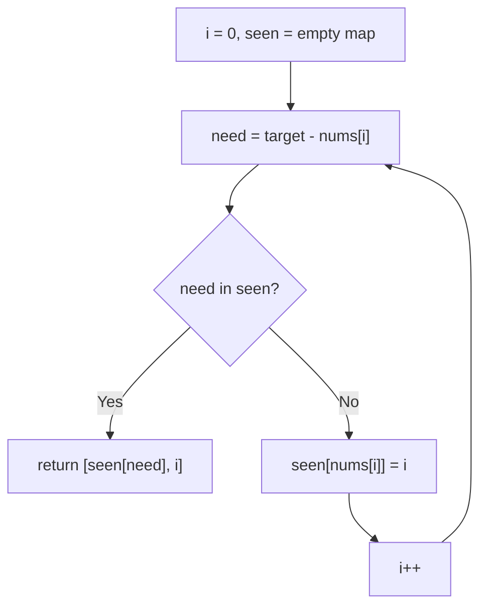

# 1. Two Sum

🟢 **Easy** · Arrays & Hashing · [Problem on LeetCode](https://leetcode.com/problems/two-sum/)

## 📝 Problem
Given an array `nums` and an integer `target`, return the **indices** of the two numbers that add up to `target`. Exactly one answer exists, and you may not use the same element twice.

## 🧠 Intuition
For every number `x`, the only number that can pair with it is `target - x`.
So instead of searching for the partner each time, we **remember** everything we've already seen in a HashMap (`value → index`). Then "does my partner exist?" becomes an O(1) lookup.

## 🪜 Approach
**🐢 Brute force:** try every pair `(i, j)` with two nested loops → `O(n²)` time.

**⚡ Optimal (one-pass HashMap):**
1. Create an empty map `seen` (value → index).
2. For each index `i`:
   - compute `need = target - nums[i]`
   - if `need` is in `seen` → answer is `[seen.get(need), i]`
   - otherwise store `nums[i] → i`
3. We check **before** inserting, so an element never pairs with itself.

## 🔁 Flow

## 🔍 Dry run
`nums = [2, 7, 11, 15]`, `target = 9`

| i | nums[i] | need | seen before | action |
|:-:|:-:|:-:|---|---|
| 0 | 2 | 7 | `{}` | store `2→0` |
| 1 | 7 | 2 | `{2:0}` | **found** → return `[0, 1]` |

## ⏱️ Complexity
| | |
|---|---|
| Time | `O(n)`: each element is visited once, and map operations are O(1) on average |
| Space | `O(n)`: the map may store every element |

## 💡 Key takeaway
"Find a pair with property X" → think **HashMap of what I've seen so far**.
