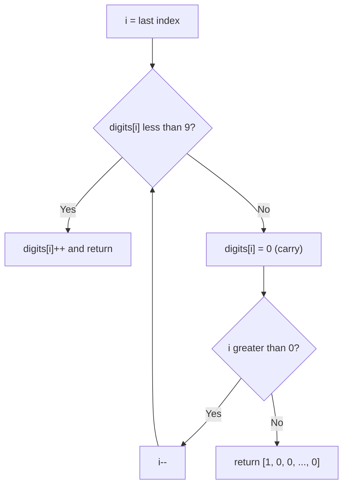

# 66. Plus One

🟢 **Easy** · Arrays · [Problem on LeetCode](https://leetcode.com/problems/plus-one/)

## 📝 Problem
A large integer is stored as an array of digits (most significant first). Add one to it and return the resulting digits.

## 🧠 Intuition
Do what you'd do on paper: start at the **last digit** and add 1.
- If the digit is `< 9`, increment it and stop, since there's no carry.
- If it's `9`, it becomes `0` and the carry moves one place left.
- If the carry falls off the front (all 9s), we need one extra digit: `1000…0`.

## 🪜 Approach
1. Loop `i` from the last index down to 0.
2. If `digits[i] < 9` → `digits[i]++`, return.
3. Else set `digits[i] = 0` and continue (carry).
4. After the loop (all were 9) → new array of length `n + 1` with a leading `1`.

## 🔁 Flow

## 🔍 Dry run
`digits = [1, 2, 9]`
- i=2: 9 → 0, carry → `[1,2,0]`
- i=1: 2 < 9 → 3 → return `[1,3,0]` ✅

`digits = [9, 9]` → `[0,0]` → all carried → `[1,0,0]` ✅

## ⏱️ Complexity
| | |
|---|---|
| Time | `O(n)` |
| Space | `O(1)` extra (a new array only for the all-9s case) |

## 💡 Key takeaway
Simulating arithmetic on digit arrays → walk from the **least significant** end and track the carry.
