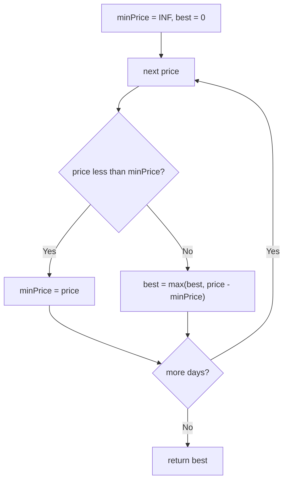

# 121. Best Time to Buy and Sell Stock

🟢 **Easy** · Arrays / Greedy · [Problem on LeetCode](https://leetcode.com/problems/best-time-to-buy-and-sell-stock/)

## 📝 Problem
`prices[i]` is the stock price on day `i`. Buy on one day and sell on a **later** day to maximise profit. Return the max profit, or `0` if no profit is possible.

## 🧠 Intuition
Imagine you sell on day `i`. The best buy day is simply the **cheapest day before `i`**.
So while scanning left to right, keep the running minimum. Each day, ask: *"If I sold today, what would I make?"*

## 🪜 Approach
**🐢 Brute force:** try every pair (buy `i`, sell `j > i`) → `O(n²)`.

**⚡ Optimal (one pass):**
1. `minPrice = +∞`, `best = 0`.
2. For each `price`:
   - if `price < minPrice` → update `minPrice`
   - else → `best = max(best, price - minPrice)`
3. Return `best`.

## 🔁 Flow

## 🔍 Dry run
`prices = [7, 1, 5, 3, 6, 4]`

| price | minPrice | profit today | best |
|:-:|:-:|:-:|:-:|
| 7 | 7 | – | 0 |
| 1 | 1 | – | 0 |
| 5 | 1 | 4 | 4 |
| 3 | 1 | 2 | 4 |
| 6 | 1 | **5** | **5** |
| 4 | 1 | 3 | 5 |

Answer: **5** (buy at 1, sell at 6).

## ⏱️ Complexity
| | |
|---|---|
| Time | `O(n)` |
| Space | `O(1)` |

## 💡 Key takeaway
"Best pair where one comes before the other" → keep a **running min/max** of the prefix.
