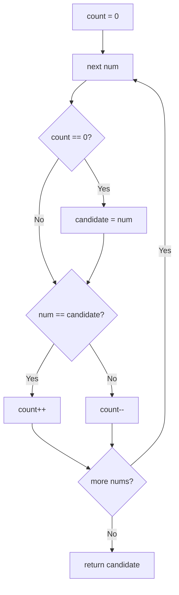

# 169. Majority Element

🟢 **Easy** · Arrays · [Problem on LeetCode](https://leetcode.com/problems/majority-element/)

## 📝 Problem
Return the element that appears **more than ⌊n / 2⌋ times**. It is guaranteed to exist.

## 🧠 Intuition
Think of it as an election. Every time two *different* values meet, they cancel each other out.
Because the majority has **more copies than all others combined**, it can never be fully cancelled, so it's the last one standing. This is the **Boyer–Moore Voting Algorithm**.

## 🪜 Approach
**🐢 Option 1:** HashMap of counts → `O(n)` time, `O(n)` space.
**🐢 Option 2:** sort and return `nums[n/2]` → `O(n log n)`.

**⚡ Optimal (Boyer–Moore):**
1. `candidate = ?`, `count = 0`.
2. For each `num`:
   - if `count == 0` → `candidate = num`
   - `count += (num == candidate) ? +1 : -1`
3. Return `candidate`.

## 🔁 Flow

## 🔍 Dry run
`nums = [2, 2, 1, 1, 1, 2, 2]`

| num | candidate | count |
|:-:|:-:|:-:|
| 2 | 2 | 1 |
| 2 | 2 | 2 |
| 1 | 2 | 1 |
| 1 | 2 | 0 |
| 1 | 1 | 1 |
| 2 | 1 | 0 |
| 2 | 2 | 1 |

Answer: **2**

## ⏱️ Complexity
| | |
|---|---|
| Time | `O(n)` |
| Space | `O(1)` |

## 💡 Key takeaway
"More than half" → **Boyer–Moore voting** gives O(1) space.
