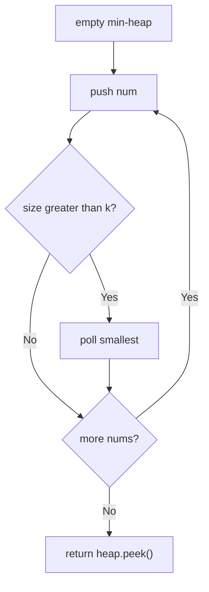

# 215. Kth Largest Element in an Array

🟡 **Medium** · Arrays / Heap · [Problem on LeetCode](https://leetcode.com/problems/kth-largest-element-in-an-array/)

## 📝 Problem
Return the **k-th largest** element in the array (in sorted order, not the k-th distinct one).

## 🧠 Intuition
We don't need the whole array sorted, only the **top k**.
Keep a **min-heap of size k**. Whenever it grows past `k`, kick out the smallest. At the end, the heap holds the k largest numbers, and its top (the smallest of them) is exactly the k-th largest.

## 🪜 Approach
**🐢 Brute force:** sort and return `nums[n - k]` → `O(n log n)`.

**⚡ Better (min-heap of size k):**
1. For each `num`: push into the heap.
2. If `heap.size() > k` → pop (remove the smallest).
3. Return `heap.peek()`.

> 🚀 Even faster on average: **Quickselect**, `O(n)` average, `O(n²)` worst case.

## 🔁 Flow

## 🔍 Dry run
`nums = [3, 2, 1, 5, 6, 4]`, `k = 2`

| num | heap after push | pop? | heap |
|:-:|---|:-:|---|
| 3 | [3] | – | [3] |
| 2 | [2,3] | – | [2,3] |
| 1 | [1,2,3] | 1 | [2,3] |
| 5 | [2,3,5] | 2 | [3,5] |
| 6 | [3,5,6] | 3 | [5,6] |
| 4 | [4,5,6] | 4 | [5,6] |

Top = **5** ✅

## ⏱️ Complexity
| | |
|---|---|
| Time | `O(n log k)` |
| Space | `O(k)` |

## 💡 Key takeaway
"k-th largest / top k" → **min-heap of size k**.
