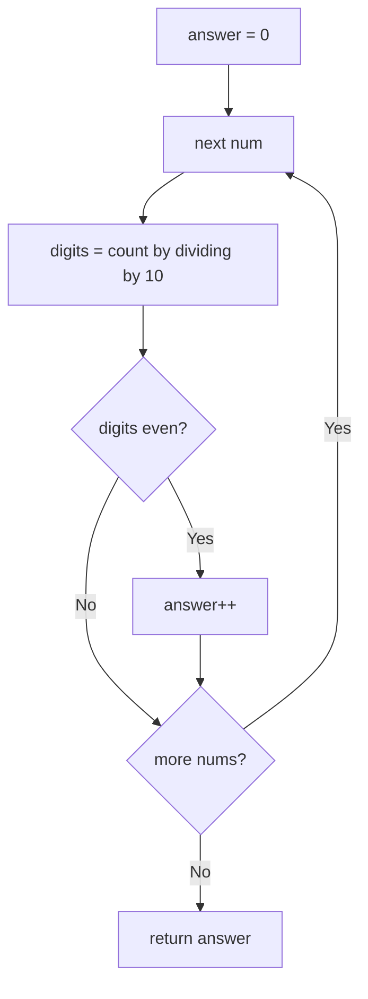

# 1295. Find Numbers with Even Number of Digits

🟢 **Easy** · Arrays / Math · [Problem on LeetCode](https://leetcode.com/problems/find-numbers-with-even-number-of-digits/)

## 📝 Problem
Return how many numbers in `nums` have an **even number of digits**.

## 🧠 Intuition
Dividing a number by 10 removes its last digit. Count how many times we can do that before reaching 0, and that's the digit count.

## 🪜 Approach
1. For each `num`, count digits with a `while (num > 0) { num /= 10; digits++; }` loop.
2. If `digits % 2 == 0`, increment the answer.

*(Alternative: `String.valueOf(num).length()`, which is shorter but creates strings.)*

## 🔁 Flow

## 🔍 Dry run
`nums = [12, 345, 2, 6, 7896]` → digits = `2, 3, 1, 1, 4` → even: `12`, `7896` → **2**

## ⏱️ Complexity
| | |
|---|---|
| Time | `O(n · d)`, where d ≤ 6 here, so effectively `O(n)` |
| Space | `O(1)` |

## 💡 Key takeaway
`num /= 10` strips a digit; `num % 10` reads the last digit. These two show up in every digit problem.
