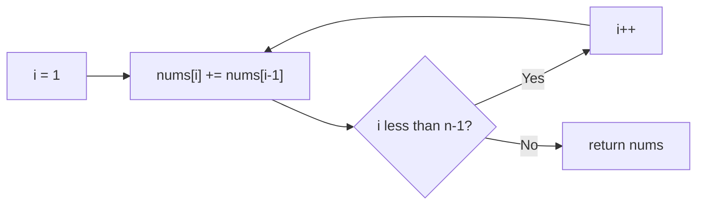

# 1480. Running Sum of 1d Array

🟢 **Easy** · Arrays / Prefix Sum · [Problem on LeetCode](https://leetcode.com/problems/running-sum-of-1d-array/)

## 📝 Problem
Return an array where `runningSum[i] = nums[0] + nums[1] + … + nums[i]`.

## 🧠 Intuition
`runningSum[i]` is just `runningSum[i-1] + nums[i]`. Since we already have the previous sum, there's no need to re-add everything from the start. This is the classic **prefix sum**.

## 🪜 Approach
**🐢 Brute force:** for every `i`, loop from 0 to i → `O(n²)`.

**⚡ Optimal:** for `i = 1 … n-1`: `nums[i] += nums[i-1]`, done in place.

## 🔁 Flow

## 🔍 Dry run
`nums = [1, 2, 3, 4]` → `[1, 3, 6, 10]`

## ⏱️ Complexity
| | |
|---|---|
| Time | `O(n)` |
| Space | `O(1)` (in place) |

## 💡 Key takeaway
Prefix sums turn "sum of a range" questions into O(1) lookups later. This problem is the foundation.
