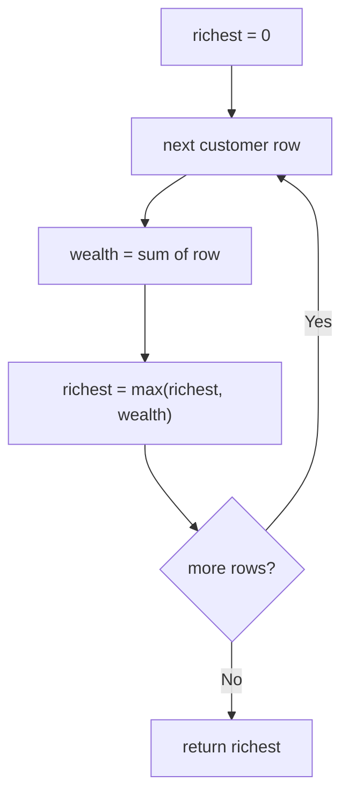

# 1672. Richest Customer Wealth

🟢 **Easy** · Arrays / Matrix · [Problem on LeetCode](https://leetcode.com/problems/richest-customer-wealth/)

## 📝 Problem
`accounts[i][j]` is the money customer `i` has in bank `j`. A customer's wealth is the sum of their row. Return the maximum wealth.

## 🧠 Intuition
Row = customer. Sum each row and remember the biggest sum.

## 🪜 Approach
1. `richest = 0`
2. For each row: `wealth = sum(row)`; `richest = max(richest, wealth)`
3. Return `richest`

## 🔁 Flow

## 🔍 Dry run
`accounts = [[1,5],[7,3],[3,5]]` → sums `6, 10, 8` → **10**

## ⏱️ Complexity
| | |
|---|---|
| Time | `O(m · n)` |
| Space | `O(1)` |

## 💡 Key takeaway
A 2D array is just an array of arrays: the outer loop picks the row, the inner loop walks it.
