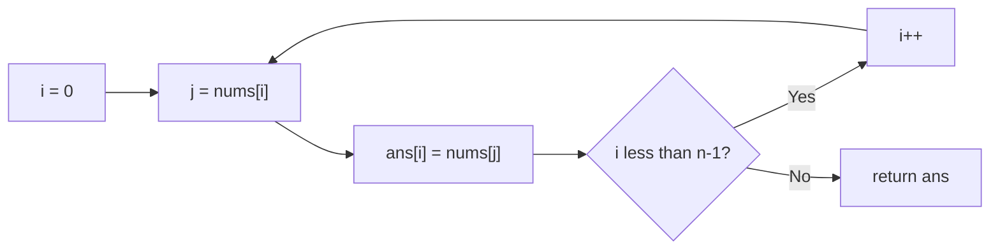

# 1920. Build Array from Permutation

🟢 **Easy** · Arrays · [Problem on LeetCode](https://leetcode.com/problems/build-array-from-permutation/)

## 📝 Problem
`nums` is a permutation of `0 … n-1`. Build `ans` where `ans[i] = nums[nums[i]]`.

## 🧠 Intuition
Translate the formula directly. Because `nums` only contains `0 … n-1`, `nums[i]` is always a valid index, so there's no out-of-bounds risk.

## 🪜 Approach
1. Create `ans` of size `n`.
2. For each `i`: `ans[i] = nums[nums[i]]`.

> 🧩 **Follow-up (O(1) extra space):** store both old and new values in one cell: `nums[i] += n * (nums[nums[i]] % n)`, then divide every cell by `n`. The `% n` recovers the old value and `/ n` the new one.

## 🔁 Flow

## 🔍 Dry run
`nums = [0, 2, 1, 5, 3, 4]`
- `ans[0] = nums[0] = 0`
- `ans[1] = nums[2] = 1`
- `ans[2] = nums[1] = 2`
- `ans[3] = nums[5] = 4`
- `ans[4] = nums[3] = 5`
- `ans[5] = nums[4] = 3`

→ `[0, 1, 2, 4, 5, 3]`

## ⏱️ Complexity
| | |
|---|---|
| Time | `O(n)` |
| Space | `O(n)` for the output (`O(1)` with the follow-up trick) |

## 💡 Key takeaway
Using array values as indices is a common pattern in permutation problems.
