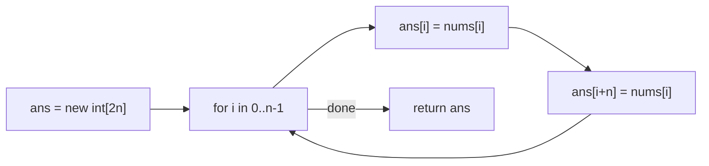

# 1929. Concatenation of Array

🟢 **Easy** · Arrays · [Problem on LeetCode](https://leetcode.com/problems/concatenation-of-array/)

## 📝 Problem
Return an array `ans` of length `2n` where `ans[i] == nums[i]` and `ans[i + n] == nums[i]`, i.e. `nums` written twice.

## 🧠 Intuition
Every element of `nums` appears twice: once at index `i`, and once shifted by `n`. So a single loop can fill both positions.

## 🪜 Approach
1. Create `ans` of size `2n`.
2. For each `i` in `0 … n-1`: `ans[i] = nums[i]`, `ans[i + n] = nums[i]`.

## 🔁 Flow

## 🔍 Dry run
`nums = [1, 2, 1]` → `[1, 2, 1, 1, 2, 1]`

## ⏱️ Complexity
| | |
|---|---|
| Time | `O(n)` |
| Space | `O(n)` for the output |

## 💡 Key takeaway
Index arithmetic (`i + n`) lets one loop fill multiple places at once.
