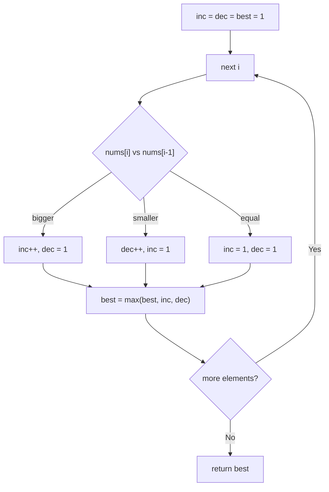

# 3105. Longest Strictly Increasing or Strictly Decreasing Subarray

🟢 **Easy** · Arrays · [Problem on LeetCode](https://leetcode.com/problems/longest-strictly-increasing-or-strictly-decreasing-subarray/)

## 📝 Problem
Given an array of integers `nums`, return the length of the longest **subarray** (contiguous) that is either **strictly increasing** or **strictly decreasing**.

| Input | Output | Why |
|---|:-:|---|
| `[1,4,3,3,2]` | `2` | `[1,4]` goes up, `[4,3]` and `[3,2]` go down. The two 3s break every run |
| `[3,3,3,3]` | `1` | Equal neighbours are never strict, so each element is alone |
| `[3,2,1]` | `3` | The whole array goes down |

## 🧠 Intuition
A subarray is contiguous, so a run only ever **continues** from the previous element or **restarts**.

Keep two counters for the run that **ends at the current index**:
- `inc`: how long the strictly increasing run is
- `dec`: how long the strictly decreasing run is

Each new element only needs to be compared with the one before it.

## 🪜 Approach
**🐢 Brute force:** try every start, extend while the direction holds → `O(n²)`. Fine for `n ≤ 50`, but there's an easy `O(n)`.

**⚡ Optimal (one pass, two counters):**
1. Start with `inc = dec = best = 1`.
2. For each `i` from 1:
   - `nums[i] > nums[i-1]` → `inc++`, `dec = 1`
   - `nums[i] < nums[i-1]` → `dec++`, `inc = 1`
   - equal → `inc = dec = 1`
3. `best = max(best, inc, dec)` after each step.

## 🔁 Flow

## 🔍 Dry run
`nums = [1,4,3,3,2]`

| i | nums[i-1] → nums[i] | Move | inc | dec | best |
|:-:|:-:|:-:|:-:|:-:|:-:|
| 0 | – | start | 1 | 1 | 1 |
| 1 | 1 → 4 | up | 2 | 1 | 2 |
| 2 | 4 → 3 | down | 1 | 2 | 2 |
| 3 | 3 → 3 | equal | 1 | 1 | 2 |
| 4 | 3 → 2 | down | 1 | 2 | 2 |

Output: `2` ✅

## ⏱️ Complexity
| | |
|---|---|
| Time | `O(n)`: one pass over the array |
| Space | `O(1)`: three counters |

## 🪤 Traps
- **Equal neighbours reset both runs.** "Strictly" means `3, 3` is neither increasing nor decreasing.
- Start `best` at **1**, not 0: a single element is always a valid answer.
- When one direction grows, **reset the other to 1**, not 0. The current element still starts a new run.

## 💡 Key takeaway
"Longest contiguous run with property X" → keep the length of the run **ending here** and reset it when the property breaks. Two properties? Keep two counters.
