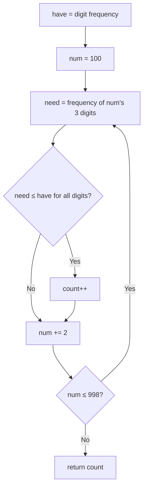

# 3483. Unique 3-Digit Even Numbers

🟢 **Easy** · Arrays / Counting · [Problem on LeetCode](https://leetcode.com/problems/unique-3-digit-even-numbers/)

## 📝 Problem
Given an array of `digits`, count the **distinct** three-digit **even** numbers you can form. Each digit in the array can be used at most once per number, and no leading zeros are allowed.

## 🧠 Intuition
Generating numbers from the digits creates duplicates (e.g. two `1`s give the same numbers twice).
Flip it around: there are only **450** three-digit even numbers (`100, 102, …, 998`). For each one, check whether the digits we have are enough to build it. Each candidate is counted at most once, so the answer is automatically "distinct".

## 🪜 Approach
1. Count how many of each digit we have → `have[0..9]`.
2. For `num = 100, 102, …, 998`:
   - split into hundreds, tens and units, and count them in `need[0..9]`
   - if `need[d] ≤ have[d]` for every `d` → `count++`
3. Return `count`.

Starting at 100 handles "no leading zero"; stepping by 2 handles "even".

## 🔁 Flow

## 🔍 Dry run
`digits = [1, 2, 3, 4]` → `have = {1,2,3,4}` each once.
Even numbers whose 3 digits are distinct and all from {1,2,3,4}, ending in 2 or 4:
- end in 2: `132, 142, 312, 342, 412, 432` (6)
- end in 4: `124, 134, 214, 234, 314, 324` (6)

→ **12** ✅

## ⏱️ Complexity
| | |
|---|---|
| Time | `O(450 · 10)` = `O(1)` after counting digits in `O(len)` |
| Space | `O(1)` |

## 💡 Key takeaway
When the answer space is **small and fixed**, enumerate answers and validate them instead of generating combinations.
