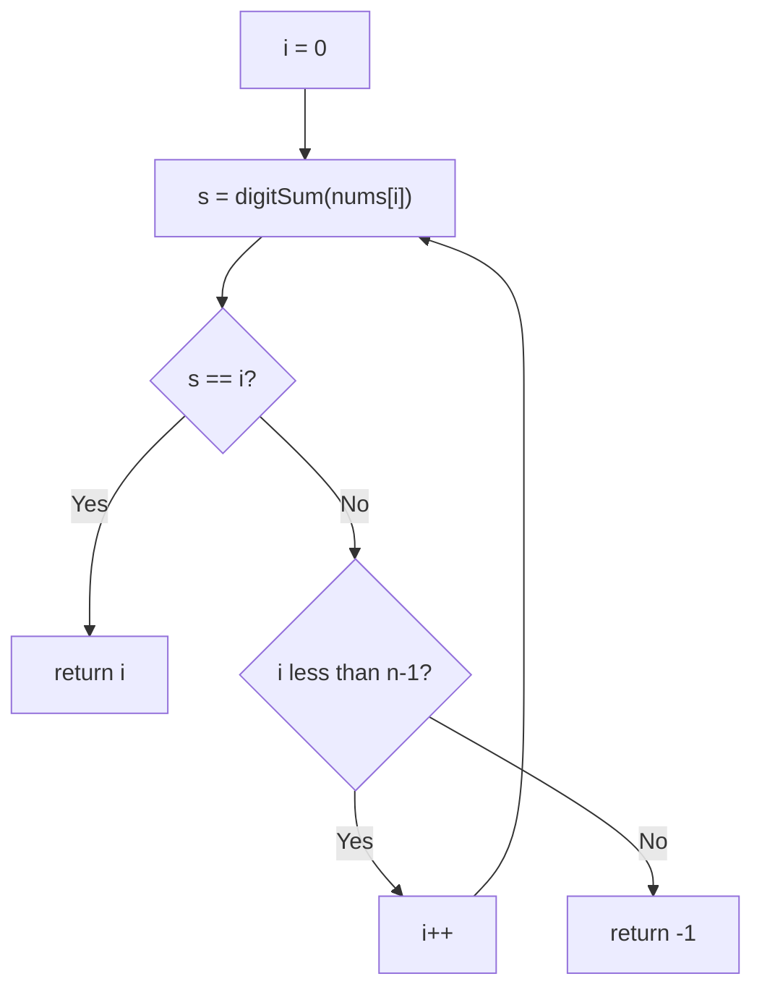

# 3550. Smallest Index With Digit Sum Equal to Index

🟢 **Easy** · Arrays / Math · [Problem on LeetCode](https://leetcode.com/problems/smallest-index-with-digit-sum-equal-to-index/)

## 📝 Problem
Return the **smallest index `i`** such that the sum of digits of `nums[i]` equals `i`. If none exists, return `-1`.

## 🧠 Intuition
Scan left to right. The **first** index that matches is automatically the smallest, so we can return immediately.

## 🪜 Approach
1. For `i = 0 … n-1`:
   - compute `digitSum(nums[i])` using `% 10` and `/ 10`
   - if it equals `i` → return `i`
2. Return `-1`.

## 🔁 Flow

## 🔍 Dry run
`nums = [1, 3, 2]`
- i=0: digitSum(1)=1 ≠ 0
- i=1: digitSum(3)=3 ≠ 1
- i=2: digitSum(2)=2 = 2 ✅ → **2**

## ⏱️ Complexity
| | |
|---|---|
| Time | `O(n · d)` |
| Space | `O(1)` |

## 💡 Key takeaway
"Smallest index such that…" → a left-to-right scan with an **early return**.
