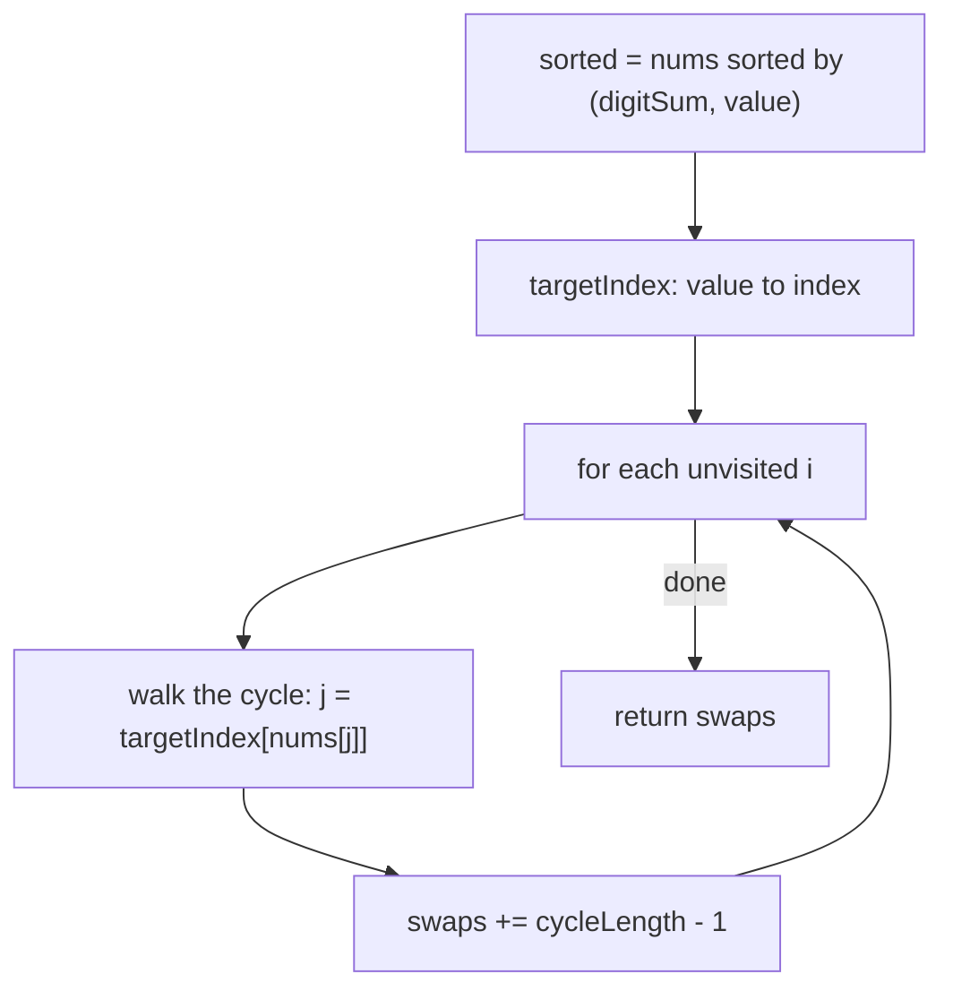

# 3551. Minimum Swaps to Sort by Digit Sum

🟡 **Medium** · Arrays / Sorting / Cycle Decomposition · [Problem on LeetCode](https://leetcode.com/problems/minimum-swaps-to-sort-by-digit-sum/)

## 📝 Problem
`nums` has **distinct** positive integers. Sort it by **digit sum** (ascending); if two numbers have the same digit sum, the smaller number comes first. Return the **minimum number of swaps** needed to reach that order.

## 🧠 Intuition
Once we know the target order, every element has a "home" index.
Draw an arrow from each index to the home of the element sitting there. These arrows form **cycles**:
- A cycle of length 1 means the element is already home, so 0 swaps.
- A cycle of length `L` can be fixed with exactly `L − 1` swaps, and no fewer.

So **minimum swaps = Σ (L − 1) = n − (number of cycles)**.

## 🪜 Approach
1. Copy and sort with the comparator *(digitSum, then value)* → `sorted`.
2. Map each value → its target index in `sorted`.
3. Use a `visited[]` array. For each unvisited `i`, follow `i → target[nums[i]] → …` until we return to a visited index, counting the cycle length `L`.
4. Add `L − 1` to the answer.

## 🔁 Flow

## 🔍 Dry run
`nums = [37, 100]` → digit sums `10, 1` → target `[100, 37]`
- i=0: 37's home is 1 → 100's home is 0 → back to start. Cycle length 2 → 1 swap.

Answer: **1** ✅

`nums = [22, 14, 33, 7]` → sums `4, 5, 6, 7` → already sorted → 4 cycles of length 1 → **0**

## ⏱️ Complexity
| | |
|---|---|
| Time | `O(n log n)` (sorting dominates; cycle walk is `O(n)`) |
| Space | `O(n)` |

## 💡 Key takeaway
"Minimum swaps to sort" → **cycle decomposition**: `answer = n − cycles`.
