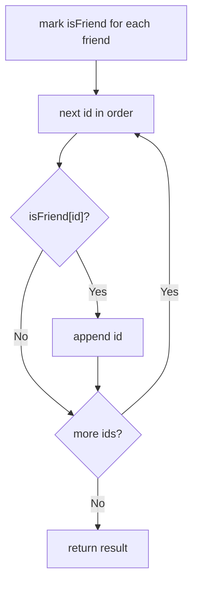

# 3668. Restore Finishing Order

🟢 **Easy** · Arrays / Hashing · [Problem on LeetCode](https://leetcode.com/problems/restore-finishing-order/)

## 📝 Problem
`order` is the finishing order of all `n` participants (ids `1 … n`). `friends` is a list of your friends' ids. Return your friends' ids **in the order they finished**.

## 🧠 Intuition
`order` already has the correct sequence; we just need to **filter** it.
To check "is this id a friend?" in O(1), mark friends in a boolean array.

## 🪜 Approach
1. `isFriend[id] = true` for every friend.
2. Walk `order`; append `id` to the result whenever `isFriend[id]`.
3. Return the result.

## 🔁 Flow

## 🔍 Dry run
`order = [3, 1, 2, 5, 4]`, `friends = [1, 3, 4]`
- 3 ✅ → [3]
- 1 ✅ → [3, 1]
- 2 ❌
- 5 ❌
- 4 ✅ → [3, 1, 4]

Answer: **[3, 1, 4]**

## ⏱️ Complexity
| | |
|---|---|
| Time | `O(n + m)` |
| Space | `O(n)` |

## 💡 Key takeaway
"Keep the order of A, but only elements in B" → **filter A** with a fast lookup of B.
