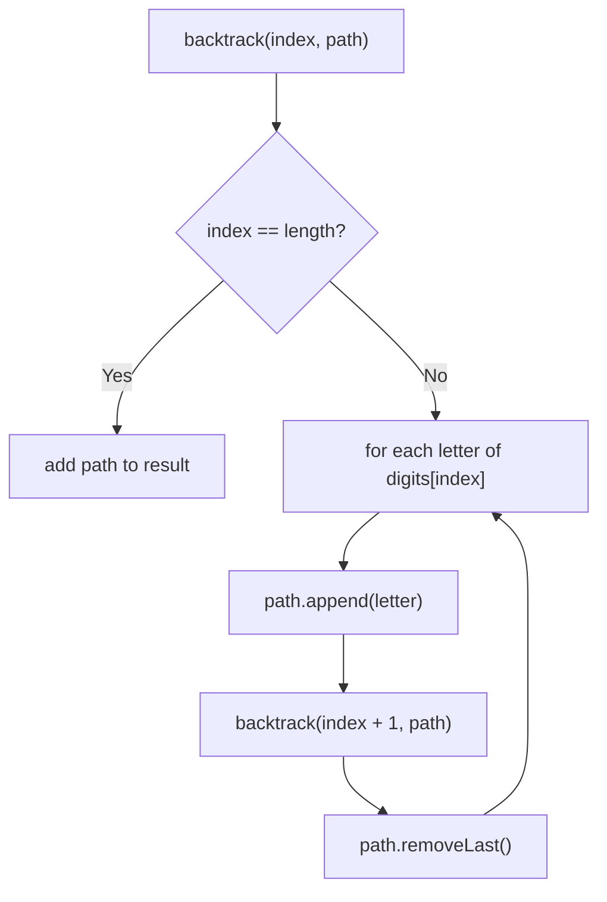
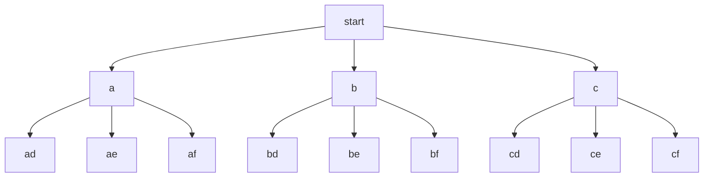

# 17. Letter Combinations of a Phone Number

🟡 **Medium** · Backtracking · [Problem on LeetCode](https://leetcode.com/problems/letter-combinations-of-a-phone-number/)

## 📝 Problem
Given digits `2–9`, return all letter combinations they could represent on a phone keypad.

## 🧠 Intuition
Each digit is a **choice point**: pick one of its 3–4 letters, then move on to the next digit. Drawn out, the choices form a tree, and every root-to-leaf path is one answer.
Walk that tree with **backtracking**: *choose → explore → un-choose*.

## 🪜 Approach
1. Map digits to letters (`2 → "abc"`, …).
2. `backtrack(index, path)`:
   - if `index == digits.length()` → add `path` to the result
   - else for each letter of `digits[index]`: append, recurse with `index + 1`, remove the last char
3. Empty input → empty list.

## 🔁 Flow

**Decision tree for `"23"`:**

## 🔍 Dry run
`digits = "23"` → `["ad","ae","af","bd","be","bf","cd","ce","cf"]` ✅

## ⏱️ Complexity
| | |
|---|---|
| Time | `O(4ⁿ · n)` |
| Space | `O(n)` recursion (plus output) |

## 💡 Key takeaway
"Generate all combinations" → **backtracking template**: choose, recurse, undo.
