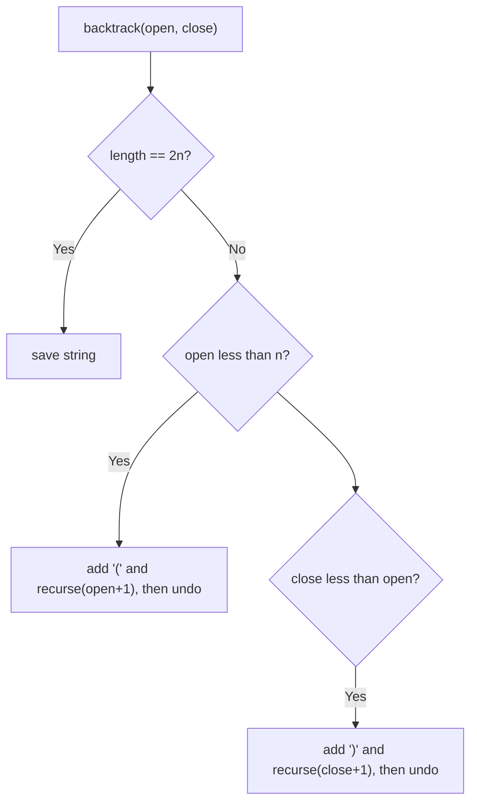

# 22. Generate Parentheses

🟡 **Medium** · Backtracking · [Problem on LeetCode](https://leetcode.com/problems/generate-parentheses/)

## 📝 Problem
Given `n` pairs of parentheses, generate **all** well-formed combinations.

## 🧠 Intuition
Generating all `2^(2n)` strings and filtering the valid ones is wasteful. Instead, **never make an invalid move**:
- add `(` if we haven't used all `n` yet → `open < n`
- add `)` only if it has something to close → `close < open`

If we only take valid steps, every string of length `2n` we reach is valid.

## 🪜 Approach
1. `backtrack(open, close, path)`:
   - length `2n` → add to the result
   - if `open < n` → add `(`, recurse, undo
   - if `close < open` → add `)`, recurse, undo

## 🔁 Flow

## 🔍 Dry run
`n = 3` → `["((()))", "(()())", "(())()", "()(())", "()()()"]` ✅ (5 = Catalan number C₃)

## ⏱️ Complexity
| | |
|---|---|
| Time | `O(4ⁿ / √n)` (the Catalan number of results) |
| Space | `O(n)` recursion |

## 💡 Key takeaway
Prune early: **only explore moves that can still lead to a valid answer**.
