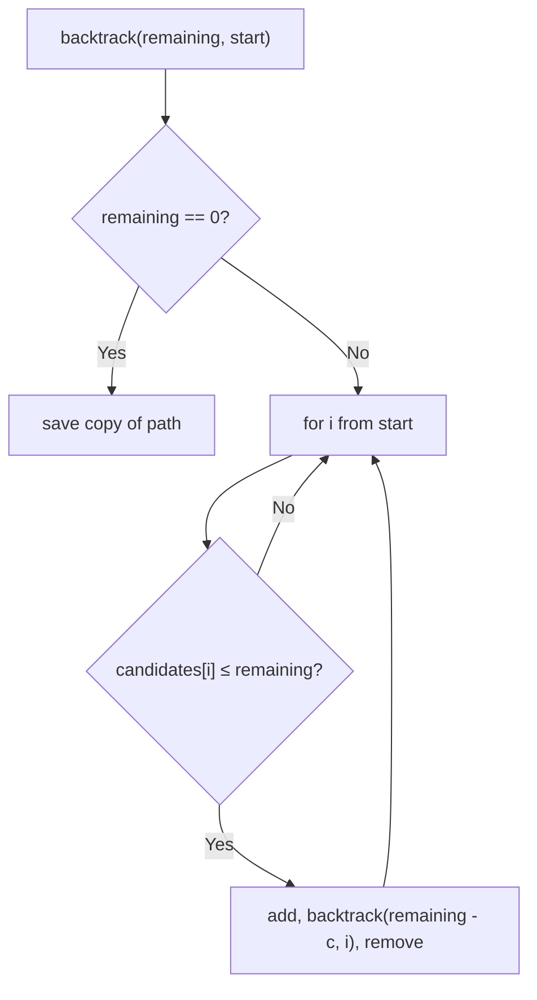

# 39. Combination Sum

🟡 **Medium** · Backtracking · [Problem on LeetCode](https://leetcode.com/problems/combination-sum/)

## 📝 Problem
Given **distinct** `candidates` and a `target`, return all **unique** combinations that sum to `target`. Each number may be used **unlimited** times.

## 🧠 Intuition
Pick a number, subtract it from the target, and solve the smaller problem: backtracking.
Two key details:
- **Reuse allowed** → after picking `candidates[i]`, recurse starting at `i` again (not `i + 1`).
- **No duplicate combos** (`[2,2,3]` vs `[3,2,2]`) → only pick from index `start` onward, so every combination is built in non-decreasing index order.

## 🪜 Approach
1. `backtrack(remaining, start, path)`:
   - `remaining == 0` → save a **copy** of `path`
   - for `i = start … n-1`: if `candidates[i] ≤ remaining` → add it, recurse with `(remaining − c, i)`, remove it

## 🔁 Flow

## 🔍 Dry run
`candidates = [2, 3, 6, 7]`, `target = 7`
- 2 → 2 → 3 ✅ `[2,2,3]`
- 7 ✅ `[7]`
- Other paths overshoot or dead-end.

Answer: **[[2,2,3],[7]]** ✅

## ⏱️ Complexity
| | |
|---|---|
| Time | Exponential, roughly `O(N^(T/M))` |
| Space | `O(T/M)` recursion depth |

## 💡 Key takeaway
Recursing with `i` lets an element be **reused**; recursing with `i + 1` uses it **once**. Using a `start` index avoids permuted duplicates.
