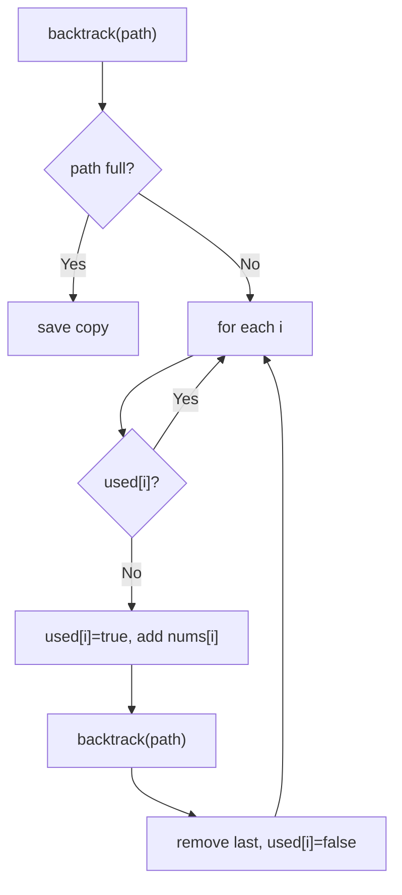

# 46. Permutations

🟡 **Medium** · Backtracking · [Problem on LeetCode](https://leetcode.com/problems/permutations/)

## 📝 Problem
Given an array of **distinct** integers, return **all possible orderings**.

## 🧠 Intuition
Build the permutation **one slot at a time**. For each slot, try every number that is **not already used**. When all slots are filled, we have one permutation.
A `used[]` boolean array tracks availability in O(1).

## 🪜 Approach
1. `backtrack(path)`:
   - `path.size() == n` → save a copy
   - for each `i` not `used`: mark used, add, recurse, remove, unmark

## 🔁 Flow


## 🔍 Dry run
`nums = [1, 2, 3]`
```
[1] → [1,2] → [1,2,3] ✅
      [1,3] → [1,3,2] ✅
[2] → [2,1,3] ✅, [2,3,1] ✅
[3] → [3,1,2] ✅, [3,2,1] ✅
```
6 = 3! permutations ✅

## ⏱️ Complexity
| | |
|---|---|
| Time | `O(n · n!)` |
| Space | `O(n)` (excluding output) |

## 💡 Key takeaway
Permutations → **`used[]` array**; combinations → **`start` index**.
