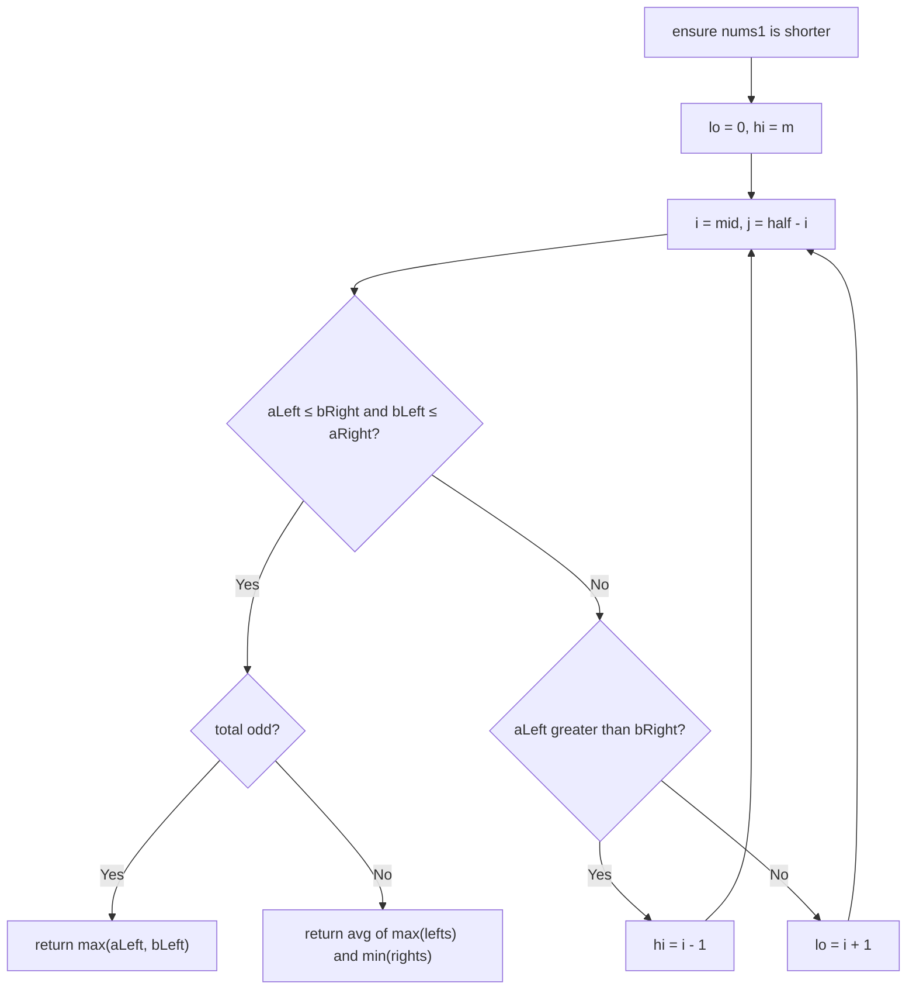

# 4. Median of Two Sorted Arrays

🔴 **Hard** · Binary Search · [Problem on LeetCode](https://leetcode.com/problems/median-of-two-sorted-arrays/)

## 📝 Problem
Given two sorted arrays of sizes `m` and `n`, return the **median** of all numbers combined. Required time: `O(log(m + n))`.

## 🧠 Intuition
The median **cuts** the combined sorted array into two halves where **everything on the left ≤ everything on the right**.

Suppose we take `i` elements from `nums1` and `j = half − i` from `nums2` for the left half. The cut is correct when:
```
nums1[i-1] ≤ nums2[j]   and   nums2[j-1] ≤ nums1[i]
```
If `nums1[i-1]` is too big → take fewer from `nums1` (move left).
If `nums2[j-1]` is too big → take more from `nums1` (move right).
That's a **binary search on `i`**.

## 🪜 Approach
**🐢 Brute force:** merge both arrays (like #88) and pick the middle → `O(m + n)`.

**⚡ Optimal (binary search on the partition):**
1. Make `nums1` the shorter array.
2. `half = (m + n + 1) / 2`, search `i` in `[0, m]`.
3. `j = half − i`. Read the four border values (use `±∞` at the edges).
4. If valid:
   - odd total → `max(aLeft, bLeft)`
   - even total → `(max(aLeft, bLeft) + min(aRight, bRight)) / 2`
5. Else move `lo` / `hi`.

## 🔁 Flow


## 🔍 Dry run
`nums1 = [1, 3]`, `nums2 = [2]` → swap so `nums1 = [2]`, `nums2 = [1, 3]`
`m = 1`, `n = 2`, `half = 2`
- `i = 0`, `j = 2`: aLeft = −∞, aRight = 2, bLeft = 3, bRight = +∞ → `bLeft (3) > aRight (2)` → `lo = 1`
- `i = 1`, `j = 1`: aLeft = 2, aRight = +∞, bLeft = 1, bRight = 3 → valid ✅
- total 3 is odd → `max(2, 1)` = **2.0**

## ⏱️ Complexity
| | |
|---|---|
| Time | `O(log(min(m, n)))` |
| Space | `O(1)` |

## 💡 Key takeaway
Binary search isn't only for finding values. You can binary search the **position of a cut** when a condition tells you which way to move.
