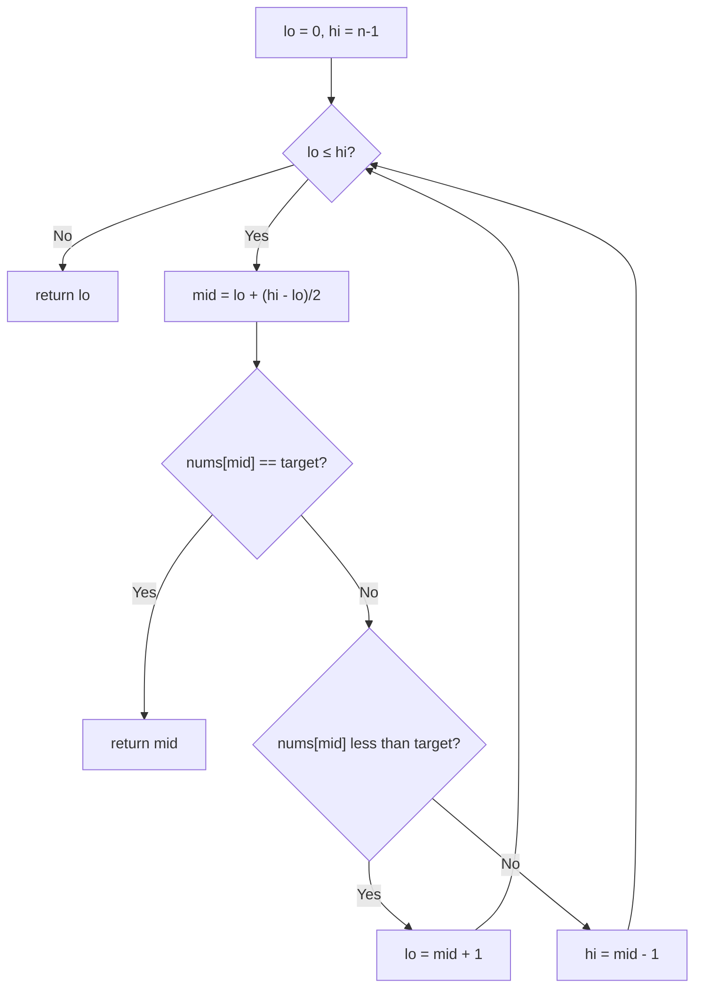

# 35. Search Insert Position

🟢 **Easy** · Binary Search · [Problem on LeetCode](https://leetcode.com/problems/search-insert-position/)

## 📝 Problem
Given a sorted array of distinct integers, return the index of `target`, or the index where it **would be inserted** to keep the order. Must be `O(log n)`.

## 🧠 Intuition
Sorted + `O(log n)` → **binary search**.
If the loop ends without finding `target`, `lo` has crossed `hi` and points at the first element **greater** than `target`, which is the insertion position.

## 🪜 Approach
1. `lo = 0`, `hi = n − 1`.
2. While `lo ≤ hi`:
   - `mid = lo + (hi − lo) / 2`
   - equal → return `mid`; smaller → `lo = mid + 1`; bigger → `hi = mid − 1`
3. Return `lo`.

## 🔁 Flow

## 🔍 Dry run
`nums = [1, 3, 5, 6]`, `target = 2`

| lo | hi | mid | nums[mid] | move |
|:-:|:-:|:-:|:-:|---|
| 0 | 3 | 1 | 3 | hi = 0 |
| 0 | 0 | 0 | 1 | lo = 1 |

`lo > hi` → return **1** ✅

## ⏱️ Complexity
| | |
|---|---|
| Time | `O(log n)` |
| Space | `O(1)` |

## 💡 Key takeaway
After a failed binary search, **`lo` is the insertion point**. This is the basis of "lower bound" searches.
