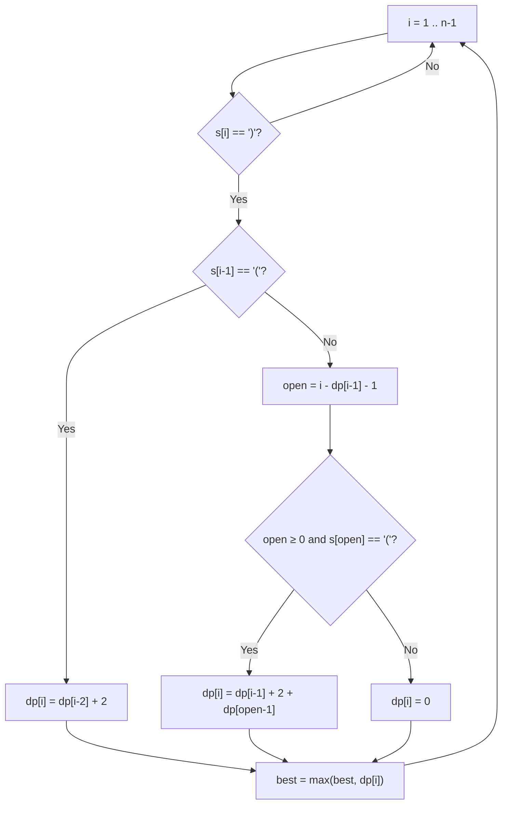

# 32. Longest Valid Parentheses

🔴 **Hard** · Dynamic Programming / Stack · [Problem on LeetCode](https://leetcode.com/problems/longest-valid-parentheses/)

## 📝 Problem
Given a string of `(` and `)`, return the length of the **longest valid (well-formed) substring**.

## 🧠 Intuition
Let `dp[i]` = length of the longest valid substring **ending exactly at index `i`**.
A valid substring always ends with `)`, so `dp[i] = 0` whenever `s[i] == '('`. Two cases when `s[i] == ')'`:

**Case 1, `"…()"`:** `s[i-1] == '('` pairs with `s[i]`.
`dp[i] = dp[i-2] + 2` (glue on whatever valid run ended just before).

**Case 2, `"…))"`:** `s[i-1]` ends a valid block of length `dp[i-1]`. Jump over that block to index `open = i − dp[i-1] − 1`. If `s[open] == '('`, it wraps the block:
`dp[i] = dp[i-1] + 2 + dp[open-1]` (plus any valid run right before `open`).

## 🪜 Approach
**🐢 Brute force:** check every substring for validity → `O(n³)`.

**⚡ DP:**
1. `dp = new int[n]`, `best = 0`.
2. For `i = 1 … n-1` with `s[i] == ')'`: apply Case 1 or Case 2.
3. `best = max(best, dp[i])`.

> 🔁 **Alternative:** a stack of indices (push `-1` first; push `(` indices; on `)` pop, and if empty push `i`, otherwise `best = max(best, i − peek)`).

## 🔁 Flow

## 🔍 Dry run
`s = "()(())"`

| i | char | case | dp[i] |
|:-:|:-:|---|:-:|
| 0 | ( | – | 0 |
| 1 | ) | "()" → 0 + 2 | 2 |
| 2 | ( | – | 0 |
| 3 | ( | – | 0 |
| 4 | ) | "()" → dp[2] + 2 | 2 |
| 5 | ) | "))": open = 5−2−1 = 2 is '(' → 2 + 2 + dp[1] | **6** |

Answer: **6** ✅

## ⏱️ Complexity
| | |
|---|---|
| Time | `O(n)` |
| Space | `O(n)` |

## 💡 Key takeaway
For substring problems, define **`dp[i]` = best answer ending at `i`**, then reuse earlier answers to extend.
