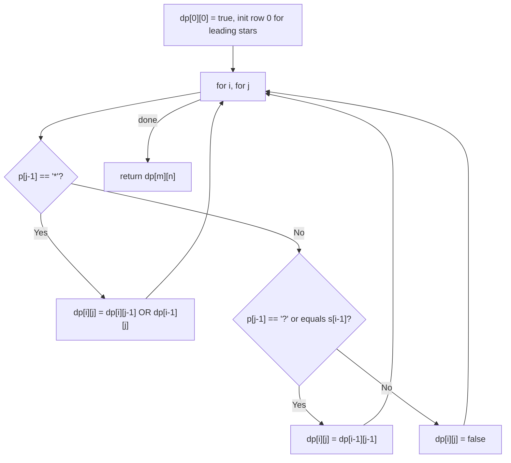

# 44. Wildcard Matching

🔴 **Hard** · Dynamic Programming / Strings · [Problem on LeetCode](https://leetcode.com/problems/wildcard-matching/)

## 📝 Problem
Implement wildcard matching where `?` matches **any single character** and `*` matches **any sequence** (including empty). The match must cover the **entire** string.

## 🧠 Intuition
Define `dp[i][j]` = *does the first `i` chars of `s` match the first `j` chars of `p`?*

Look at the last pattern char `p[j-1]`:
- **letter or `?`:** it must consume exactly one char → `dp[i-1][j-1]` (and the letters must be equal).
- **`*`:** two choices:
  - match **empty** → ignore the star: `dp[i][j-1]`
  - match **one more char** of `s` and keep the star available: `dp[i-1][j]`

**Base cases:** `dp[0][0] = true`; `dp[0][j]` is true only if `p[0..j)` is all `*`.

## 🪜 Approach
1. Build a `(m+1) × (n+1)` boolean table.
2. Fill base cases.
3. Fill row by row using the rules above.
4. Return `dp[m][n]`.

## 🔁 Flow

## 🔍 Dry run
`s = "adceb"`, `p = "*a*b"` → **true**
- leading `*` matches empty
- `a` matches `a`
- `*` swallows `dce`
- `b` matches `b` ✅

`s = "cb"`, `p = "?a"` → `?` matches `c`, but `a ≠ b` → **false**

## ⏱️ Complexity
| | |
|---|---|
| Time | `O(m · n)` |
| Space | `O(m · n)` (can be reduced to `O(n)` with a rolling row) |

## 💡 Key takeaway
String-matching with wildcards → **2D DP on prefixes**. For `*`, think "use it for nothing" vs "use it for one more char".
