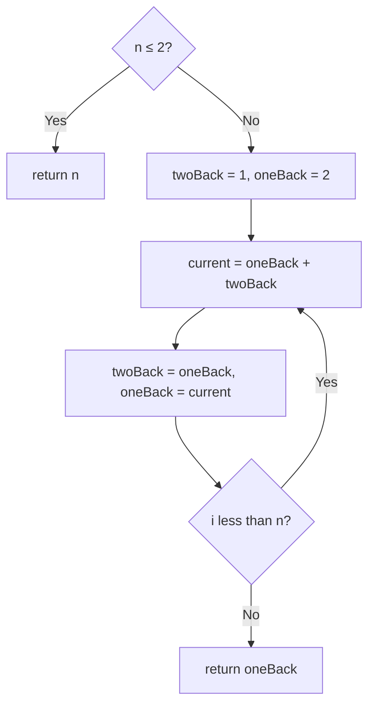

# 70. Climbing Stairs

🟢 **Easy** · Dynamic Programming · [Problem on LeetCode](https://leetcode.com/problems/climbing-stairs/)

## 📝 Problem
You climb `n` stairs taking **1 or 2 steps** at a time. How many distinct ways can you reach the top?

## 🧠 Intuition
Think about the **last move** onto step `i`:
- it was a 1-step from `i − 1`, or
- a 2-step from `i − 2`.

So `ways(i) = ways(i − 1) + ways(i − 2)`, which is **Fibonacci**!
We only need the previous two values, so two variables are enough.

## 🪜 Approach
**🐢 Plain recursion:** `ways(n-1) + ways(n-2)` → `O(2ⁿ)` (recomputes the same steps).
**🙂 Memo / DP array:** `O(n)` time, `O(n)` space.
**⚡ Two variables:** `O(n)` time, `O(1)` space.

1. `n ≤ 2` → return `n`.
2. `twoBack = 1`, `oneBack = 2`.
3. For `i = 3 … n`: `current = oneBack + twoBack`; shift the window.
4. Return `oneBack`.

## 🔁 Flow

## 🔍 Dry run
`n = 5` → ways: `1, 2, 3, 5, 8` → **8** ✅

## ⏱️ Complexity
| | |
|---|---|
| Time | `O(n)` |
| Space | `O(1)` |

## 💡 Key takeaway
The DP starter problem: **define the state, find the recurrence, keep only what you need**.
