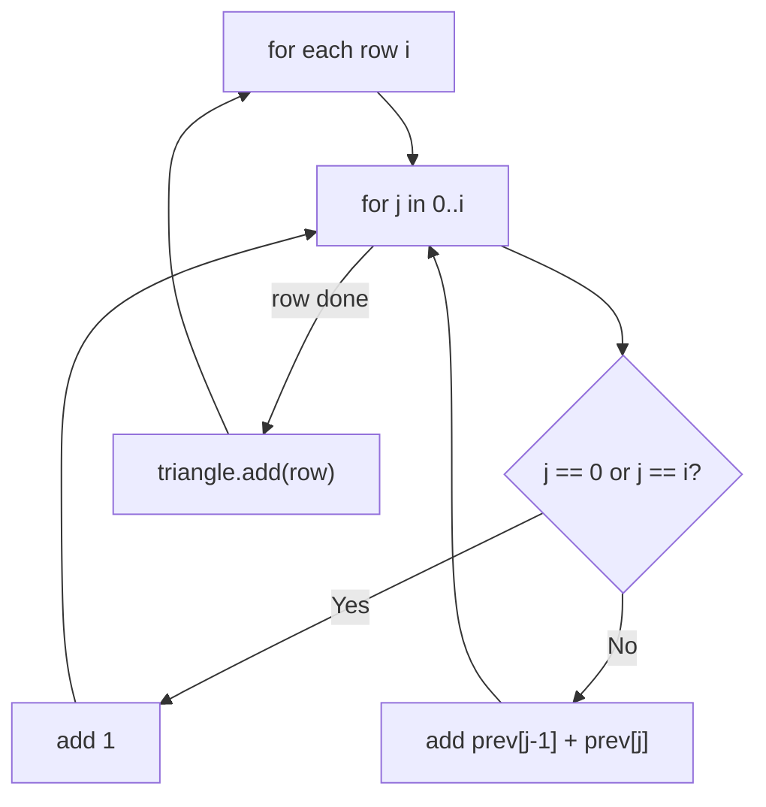

# 118. Pascal's Triangle

🟢 **Easy** · Dynamic Programming / Arrays · [Problem on LeetCode](https://leetcode.com/problems/pascals-triangle/)

## 📝 Problem
Return the first `numRows` rows of **Pascal's triangle**.

## 🧠 Intuition
Each row is built from the row above:
- first and last values are `1`
- every inner value = the **two numbers above it** added together: `row[j] = prev[j-1] + prev[j]`

```
        1
       1 1
      1 2 1
     1 3 3 1
    1 4 6 4 1
```

## 🪜 Approach
1. For `i = 0 … numRows-1`, build a row of size `i + 1`.
2. `j == 0` or `j == i` → `1`; else → `prev[j-1] + prev[j]`.
3. Add the row to the triangle.

## 🔁 Flow


## 🔍 Dry run
`numRows = 5` → `[[1],[1,1],[1,2,1],[1,3,3,1],[1,4,6,4,1]]` ✅

## ⏱️ Complexity
| | |
|---|---|
| Time | `O(numRows²)` |
| Space | `O(1)` extra |

## 💡 Key takeaway
Pascal's triangle gives binomial coefficients `C(n, k)`. It's reused in combinatorics problems like **#1569** in this repo.
