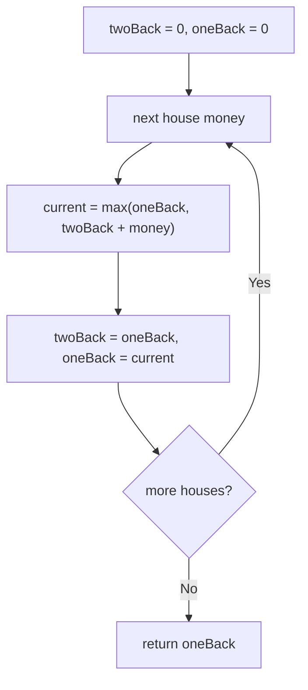

# 198. House Robber

🟡 **Medium** · Dynamic Programming · [Problem on LeetCode](https://leetcode.com/problems/house-robber/)

## 📝 Problem
Houses in a row hold `nums[i]` money. You can't rob **two adjacent** houses. Return the maximum you can rob.

## 🧠 Intuition
At each house there are only two choices:
- **Skip it:** the best stays whatever it was up to the previous house → `best(i-1)`
- **Rob it:** you can't have robbed `i-1`, so → `best(i-2) + nums[i]`

`best(i) = max(best(i-1), best(i-2) + nums[i])`

Like Climbing Stairs, we only need the last two values.

## 🪜 Approach
**🐢 Recursion:** try rob/skip at each house → `O(2ⁿ)`.
**⚡ DP with two variables:**
1. `twoBack = 0`, `oneBack = 0`.
2. For each `money`: `current = max(oneBack, twoBack + money)`; shift.
3. Return `oneBack`.

## 🔁 Flow

## 🔍 Dry run
`nums = [2, 7, 9, 3, 1]`

| money | skip (oneBack) | rob (twoBack + money) | best |
|:-:|:-:|:-:|:-:|
| 2 | 0 | 2 | 2 |
| 7 | 2 | 7 | 7 |
| 9 | 7 | 11 | 11 |
| 3 | 11 | 10 | 11 |
| 1 | 11 | 12 | **12** |

Answer: **12** (2 + 9 + 1) ✅

## ⏱️ Complexity
| | |
|---|---|
| Time | `O(n)` |
| Space | `O(1)` |

## 💡 Key takeaway
"Take it or leave it, with a constraint on neighbours" → **include / exclude DP**.
