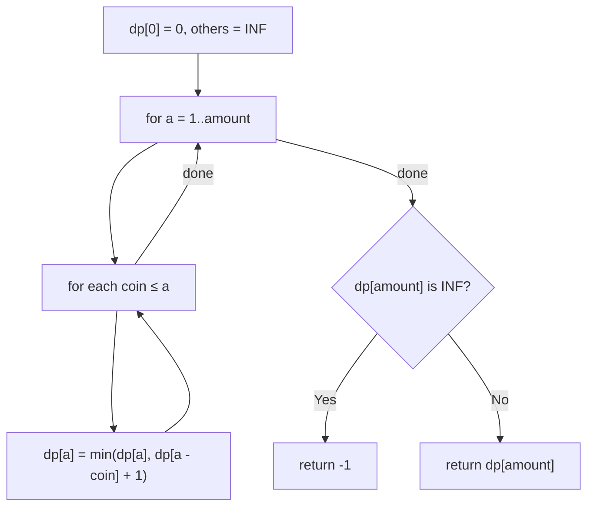

# 322. Coin Change

🟡 **Medium** · Dynamic Programming · [Problem on LeetCode](https://leetcode.com/problems/coin-change/)

## 📝 Problem
Given coin denominations (unlimited supply) and an `amount`, return the **fewest coins** needed to make that amount, or `-1` if it's impossible.

## 🧠 Intuition
**Greedy fails:** with coins `[1, 3, 4]` and amount `6`, greedy picks `4+1+1` (3 coins), but `3+3` (2 coins) is better.

Use DP: `dp[a]` = fewest coins to make amount `a`.
The last coin used is some `c`, leaving `a − c`, which we have already solved:
`dp[a] = min over coins c of (dp[a − c] + 1)`

## 🪜 Approach
1. `dp[0] = 0`; everything else = `amount + 1` (acts as ∞).
2. For `a = 1 … amount`, for each `coin ≤ a`: `dp[a] = min(dp[a], dp[a − coin] + 1)`.
3. Return `dp[amount]`, or `-1` if it's still ∞.

## 🔁 Flow

## 🔍 Dry run
`coins = [1, 2, 5]`, `amount = 11`

| a | 0 | 1 | 2 | 3 | 4 | 5 | 6 | 7 | 8 | 9 | 10 | 11 |
|---|---|---|---|---|---|---|---|---|---|---|---|---|
| dp | 0 | 1 | 1 | 2 | 2 | 1 | 2 | 2 | 3 | 3 | 2 | **3** |

Answer: **3** (5 + 5 + 1) ✅

## ⏱️ Complexity
| | |
|---|---|
| Time | `O(amount × coins)` |
| Space | `O(amount)` |

## 💡 Key takeaway
"Minimum number of items to reach a total, items reusable" → **unbounded knapsack DP** over the total.
