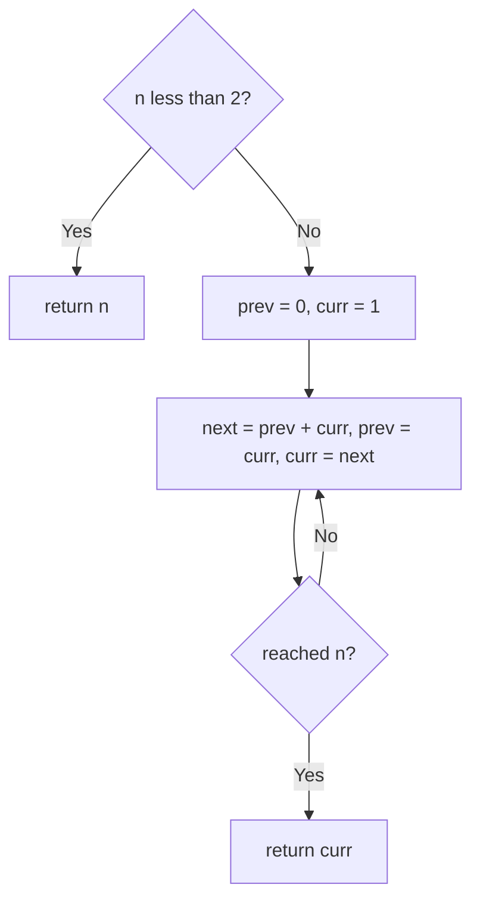
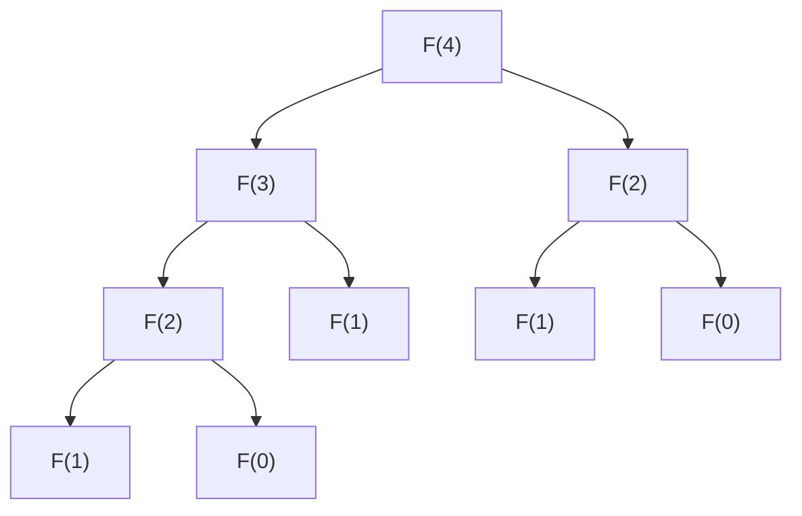

# 509. Fibonacci Number

🟢 **Easy** · Dynamic Programming / Math · [Problem on LeetCode](https://leetcode.com/problems/fibonacci-number/)

## 📝 Problem
Return `F(n)` where `F(0) = 0`, `F(1) = 1`, and `F(n) = F(n-1) + F(n-2)`.

## 🧠 Intuition
Plain recursion recomputes the same values again and again: `F(5)` calls `F(3)` twice, `F(2)` three times, …, which is exponential.
**Bottom-up:** start from `F(0)`, `F(1)` and walk upward, keeping only the last two values.

## 🪜 Approach
**🐢 Recursion:** `O(2ⁿ)`.
**🙂 Memoization:** cache results → `O(n)` time and space.
**⚡ Iterative:**
1. `n < 2` → return `n`.
2. `prev = 0`, `curr = 1`; repeat `n − 1` times: `next = prev + curr`, shift.
3. Return `curr`.

## 🔁 Flow

**Why recursion is slow:**

`F(2)` is computed twice even for `n = 4`, and it gets much worse as `n` grows.

## 🔍 Dry run
`n = 6` → `0, 1, 1, 2, 3, 5, 8` → **8** ✅

## ⏱️ Complexity
| | |
|---|---|
| Time | `O(n)` |
| Space | `O(1)` |

## 💡 Key takeaway
Overlapping subproblems → **remember results** (memo) or **build bottom-up**. That is what DP means.
