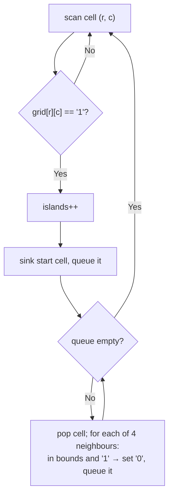

# 200. Number of Islands

🟡 **Medium** · Graphs / BFS · [Problem on LeetCode](https://leetcode.com/problems/number-of-islands/)

## 📝 Problem
Given an `m × n` grid of `'1'` (land) and `'0'` (water), count the islands. An island is land connected **horizontally or vertically** (not diagonally), surrounded by water. The grid's edges count as water.

## 🧠 Intuition
This is a **graph problem wearing a grid costume**:
- every land cell is a **node**
- it has an **edge** to each land cell directly up, down, left and right
- an island is a **connected component**

Counting islands = counting connected components. Scan the grid; the first time you step on land you haven't seen, you've found a new island. Explore **all** of it right away (flood fill) and mark it visited, so the scan never counts it again.

Trick: instead of a separate `visited` array, **sink** the land by turning each `'1'` into `'0'` as you explore it.

## 🪜 Approach
1. For every cell `(r, c)`:
   - if it's `'1'`, add one to `islands` and flood-fill from it.
2. Flood fill (BFS):
   - set the start cell to `'0'` and put it in a queue
   - pop a cell, look at its 4 neighbours; each in-bounds `'1'` becomes `'0'` and joins the queue
   - stop when the queue is empty: the whole island has sunk
3. Return `islands`.

## 🔁 Flow


## 🔍 Dry run
```
1 1 0 0 0
1 1 0 0 0
0 0 1 0 0
0 0 0 1 1
```
| Scan reaches | What happens | islands |
|---|---|:-:|
| (0,0) = 1 | BFS sinks (0,0) (0,1) (1,0) (1,1) | 1 |
| (2,2) = 1 | BFS sinks (2,2) only (diagonals don't count) | 2 |
| (3,3) = 1 | BFS sinks (3,3) (3,4) | 3 |

Answer: **3** ✅

## 🪤 Traps
- **Mark visited when you add to the queue,** not when you pop. Otherwise the same cell can be queued several times.
- **Diagonals are not connected.** Only 4 directions.
- **It's `char`, not `int`:** compare with `'1'`, not `1`.
- **Recursive DFS on a huge all-land grid** can overflow the stack (300×300 = 90,000 calls deep). BFS with a queue avoids that.
- Sinking **changes the input**. If you must keep the grid, use a `boolean[][] visited` instead.

## 🌱 Other ways
- **DFS** (recursive or with a stack): same idea, same `O(m·n)`.
- **Union-Find:** union every pair of adjacent land cells; the answer is the number of distinct roots. Handy when land is added over time (305. Number of Islands II).

## ⏱️ Complexity
| | |
|---|---|
| Time | `O(m·n)` |
| Space | `O(min(m, n))` for the BFS queue |

## 💡 Key takeaway
A grid of cells is a graph with 4 edges per cell. **"How many groups?" = count connected components:** scan, and flood-fill each new one you find.
