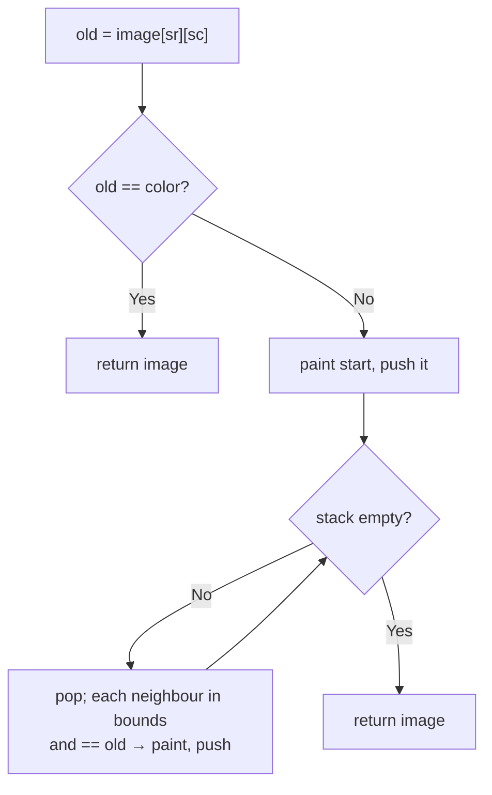

# 733. Flood Fill

🟢 **Easy** · Graphs / DFS · [Problem on LeetCode](https://leetcode.com/problems/flood-fill/)

## 📝 Problem
An image is a grid of pixel colours. Starting from pixel `(sr, sc)`, repaint it and every pixel **connected** to it (up, down, left, right) that has the **same original colour** with `color`. Return the image.

## 🧠 Intuition
It's the **paint-bucket tool** from any drawing app. The starting pixel and all same-coloured pixels you can reach from it, one step at a time, form a **connected component**. Paint that whole component.

This is exactly the flood fill from [200. Number of Islands](../0200-number-of-islands/README.md): there it sank land to water, here it paints one colour over another.

## 🪜 Approach
1. Remember `old = image[sr][sc]`.
2. **If `old == color`, return the image unchanged.** (See the trap below.)
3. Paint `(sr, sc)` and push it on a stack.
4. While the stack isn't empty: pop a pixel; for each of its 4 neighbours that's inside the image and still `old`, paint it and push it.
5. Return the image.

## 🔁 Flow


## 🔍 Dry run
`image = [[1,1,1],[1,1,0],[1,0,1]]`, start `(1,1)`, `color = 2`

```
before        after
1 1 1         2 2 2
1 1 0   ──►   2 2 0
1 0 1         2 0 1
```
Every `1` connected to the centre turns into `2`. The bottom-right `1` stays: it only touches the centre diagonally, and diagonals don't count. ✅

## 🪤 Traps
- **New colour = old colour.** Without the early return, painted pixels still look like `old`, so the fill keeps pushing them forever (or until the stack overflows). Return right away.
- **Paint when you push, not when you pop,** so a pixel never gets pushed twice.
- **Only 4 directions,** never diagonals.

## 🌱 Recursive version
```java
void fill(int[][] img, int r, int c, int old, int color) {
    if (r < 0 || r >= img.length || c < 0 || c >= img[0].length || img[r][c] != old) return;
    img[r][c] = color;
    fill(img, r + 1, c, old, color); fill(img, r - 1, c, old, color);
    fill(img, r, c + 1, old, color); fill(img, r, c - 1, old, color);
}
```
Shorter, and fine for LeetCode's 50×50 limit; the explicit stack is safer for big images.

## ⏱️ Complexity
| | |
|---|---|
| Time | `O(m·n)` |
| Space | `O(m·n)` |

## 💡 Key takeaway
Flood fill = **explore one connected component and change it as you go.** Always ask: can the change leave a cell looking unvisited? If so, guard against it.
