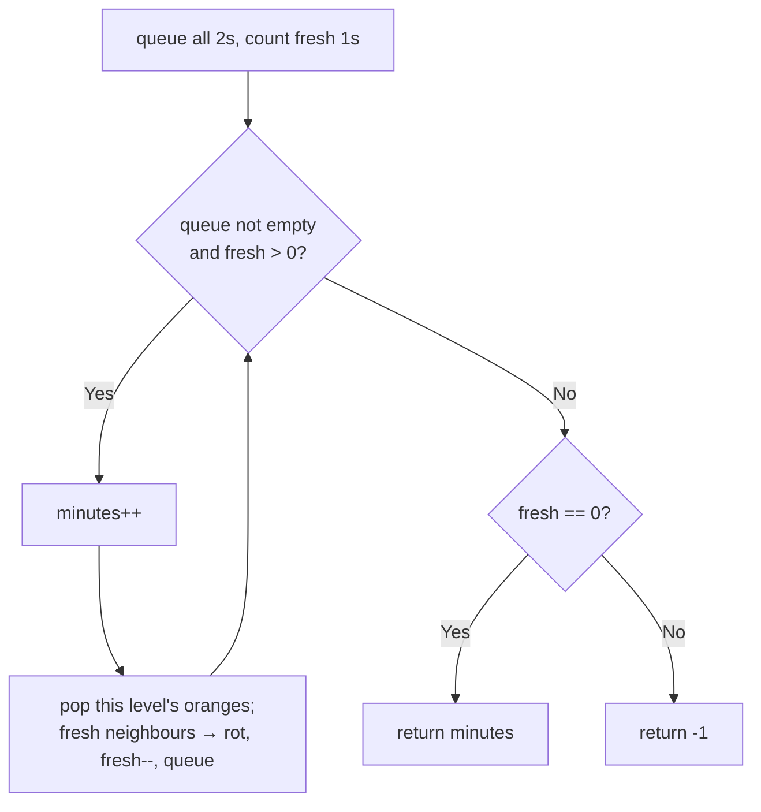

# 994. Rotting Oranges

🟡 **Medium** · Graphs / Multi-source BFS · [Problem on LeetCode](https://leetcode.com/problems/rotting-oranges/)

## 📝 Problem
A grid has `0` (empty), `1` (fresh orange) and `2` (rotten orange). Every minute, each fresh orange **next to** a rotten one (up, down, left, right) turns rotten. Return the minutes until no fresh orange is left, or `-1` if that never happens.

## 🧠 Intuition
Two ideas:

1. **Everything rots at the same time.** All rotten oranges spread at once, so start a BFS from **all of them together**: put every rotten orange in the queue before you begin. This is called **multi-source BFS**.
2. **BFS levels are minutes.** Process the queue one level at a time (`size = queue.size()`, then pop exactly that many). Everything in one level rots in the same minute, and it rots the next level.

Count the fresh oranges first. Each new rot subtracts one. If the queue runs dry while `fresh > 0`, some oranges are walled off by empty cells: answer `-1`.

## 🪜 Approach
1. Scan the grid: queue every `2`, count every `1` as `fresh`.
2. `minutes = 0`. While the queue isn't empty **and** `fresh > 0`:
   - `minutes++`
   - pop exactly `queue.size()` oranges (this minute's rotten ones); each fresh neighbour becomes `2`, `fresh--`, and joins the queue
3. Return `minutes` if `fresh == 0`, else `-1`.

## 🔁 Flow


## 🔍 Dry run
```
2 1 1
1 1 0
0 1 1
```
| Minute | Rots | fresh left |
|:-:|---|:-:|
| 0 | start: (0,0) | 6 |
| 1 | (0,1) (1,0) | 4 |
| 2 | (0,2) (1,1) | 2 |
| 3 | (2,1) | 1 |
| 4 | (2,2) | 0 |

Answer: **4** ✅

`[[2,1,1],[0,1,1],[1,0,1]]`: the bottom-left `1` is boxed in by empty cells, so it never rots → **-1**.

## 🪤 Traps
- **Starting a BFS from each rotten orange separately** gives the wrong time: they spread together, not one after another.
- **Counting a minute when nothing rotted.** The loop stops as soon as `fresh == 0`, so the last level doesn't add an extra minute.
- **No fresh oranges at all** → answer `0`, even if there are no rotten ones.
- **Fresh oranges but no rotten ones** → `-1`.

## ⏱️ Complexity
| | |
|---|---|
| Time | `O(m·n)` |
| Space | `O(m·n)` |

## 💡 Key takeaway
"Spreads from several places at once, how long until…?" → **multi-source BFS**: queue every source first, and **each BFS level is one time step.**
