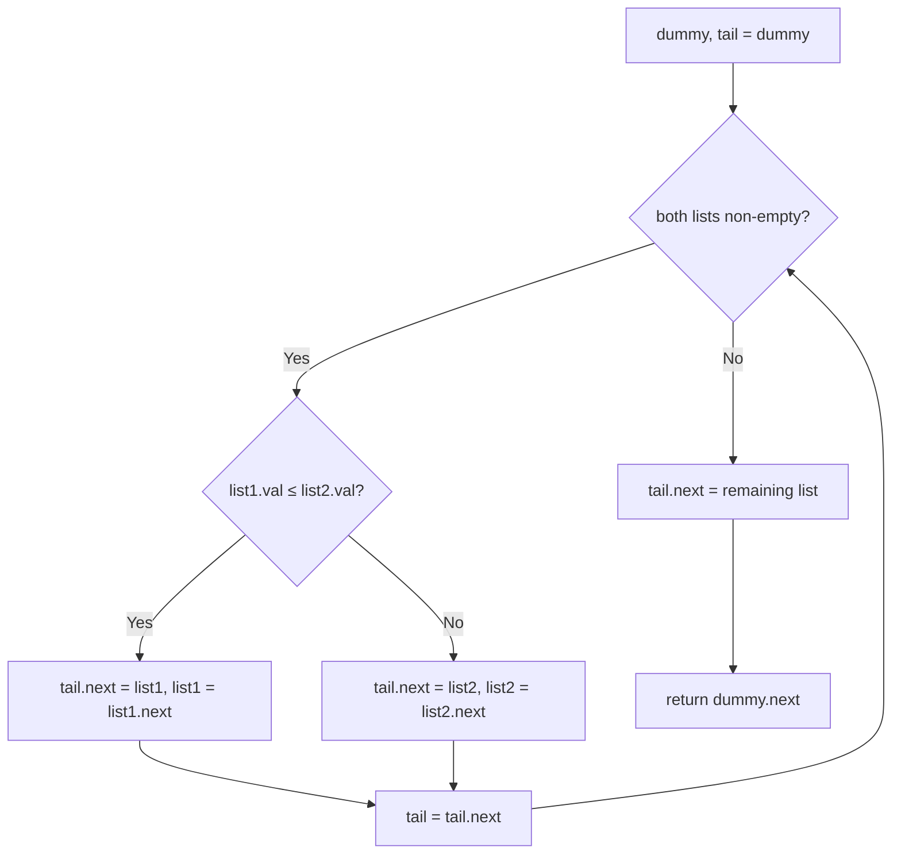

# 21. Merge Two Sorted Lists

🟢 **Easy** · Linked Lists · [Problem on LeetCode](https://leetcode.com/problems/merge-two-sorted-lists/)

## 📝 Problem
Merge two sorted linked lists into one sorted list by splicing their nodes together. Return the head.

## 🧠 Intuition
Like merging two sorted piles of cards: look at the top of each pile and take the **smaller** one.
A **dummy head** node means we never need an `if (head == null)` special case; we just keep appending to `tail`.

## 🪜 Approach
1. `dummy = new ListNode()`, `tail = dummy`.
2. While both lists are non-empty: link the smaller node to `tail.next`, advance that list and `tail`.
3. Attach the remaining list (one is already empty).
4. Return `dummy.next`.

## 🔁 Flow

## 🔍 Dry run
`list1 = 1→2→4`, `list2 = 1→3→4`

Take 1(l1), 1(l2), 2(l1), 3(l2), 4(l1), then attach the rest, 4(l2) →
**1→1→2→3→4→4** ✅

## ⏱️ Complexity
| | |
|---|---|
| Time | `O(m + n)` |
| Space | `O(1)` (nodes are reused) |

## 💡 Key takeaway
Building a new linked list → start with a **dummy node** to avoid head edge cases.
