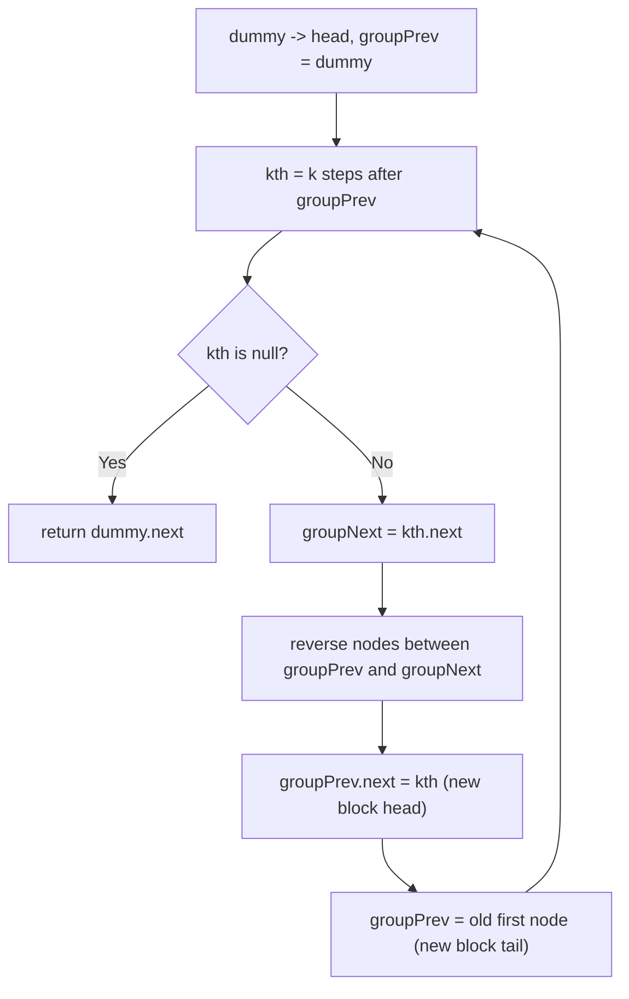

# 25. Reverse Nodes in k-Group

🔴 **Hard** · Linked Lists · [Problem on LeetCode](https://leetcode.com/problems/reverse-nodes-in-k-group/)

## 📝 Problem
Reverse the nodes of a linked list **k at a time**. If the last block has fewer than `k` nodes, leave it as is. Only node links may change, not values.

## 🧠 Intuition
Break the problem into repeated small steps. For each block of `k` nodes:
1. **Check** there are `k` nodes (find the `k`-th node).
2. **Reverse** those `k` nodes (the classic reverse-a-list loop, but stopping at the block's end).
3. **Reconnect** the reversed block to the part before it and the part after it.

A dummy node in front of the head makes the first block behave like every other block.

## 🪜 Approach
1. `dummy → head`, `groupPrev = dummy`.
2. Loop:
   - walk `k` steps from `groupPrev` to find `kth`; if it's `null`, stop
   - `groupNext = kth.next`
   - reverse nodes from `groupPrev.next` up to `kth`, starting with `prev = groupNext` so the reversed block's tail already points to the rest
   - `oldFirst = groupPrev.next`; `groupPrev.next = kth`; `groupPrev = oldFirst`
3. Return `dummy.next`.

## 🔁 Flow

## 🔍 Dry run
`head = 1→2→3→4→5`, `k = 2`
- Block `1,2` → `2→1`, list: `2→1→3→4→5`
- Block `3,4` → `4→3`, list: `2→1→4→3→5`
- Block `5` has fewer than 2 nodes → stop

Answer: **2→1→4→3→5** ✅

## ⏱️ Complexity
| | |
|---|---|
| Time | `O(n)` |
| Space | `O(1)` |

## 💡 Key takeaway
Hard linked-list problems are usually **"reverse a list" + careful reconnection**. Keep pointers to the node *before* and *after* the segment.
