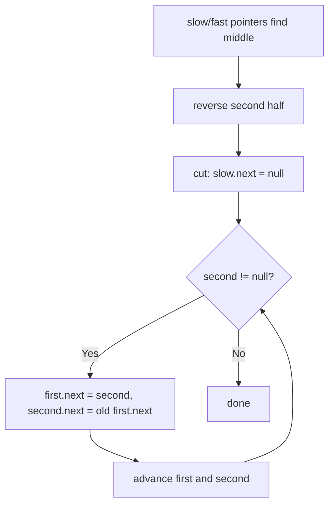

# 143. Reorder List

🟡 **Medium** · Linked Lists · [Problem on LeetCode](https://leetcode.com/problems/reorder-list/)

## 📝 Problem
Reorder `L0 → L1 → … → Ln` into `L0 → Ln → L1 → Ln-1 → L2 → Ln-2 → …` in place.

## 🧠 Intuition
The result alternates between the **front half** (in order) and the **back half** (in reverse). This breaks into three classic linked-list moves:
1. **Find the middle** (slow/fast pointers)
2. **Reverse** the second half
3. **Merge** the two halves by alternating nodes

## 🪜 Approach
**🐢 Simple:** copy nodes into an array, then relink using two indices → `O(n)` extra space.

**⚡ Optimal (O(1) space):**
1. `slow` moves 1 step, `fast` moves 2 → `slow` stops at the end of the first half.
2. `second = reverse(slow.next)`; `slow.next = null`.
3. While `second != null`: link `first → second → first.next`, then advance both.

## 🔁 Flow

## 🔍 Dry run
`1 → 2 → 3 → 4 → 5`
1. middle: slow at `3` → halves `1→2→3` and `4→5`
2. reverse second: `5→4`
3. weave: `1→5→2→4→3` ✅

## ⏱️ Complexity
| | |
|---|---|
| Time | `O(n)` |
| Space | `O(1)` |

## 💡 Key takeaway
Complex list rearrangements often = **middle + reverse + merge** combined.
