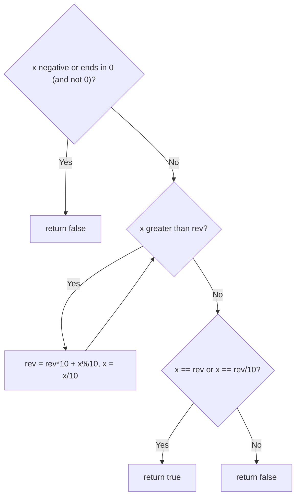

# 9. Palindrome Number

🟢 **Easy** · Math · [Problem on LeetCode](https://leetcode.com/problems/palindrome-number/)

## 📝 Problem
Return `true` if the integer `x` reads the same forwards and backwards.

## 🧠 Intuition
A palindrome's **second half reversed** equals its **first half**.
Peel digits off the end of `x` (`x % 10`) and build `reversedHalf`. Once `reversedHalf ≥ x`, we've reached the middle, so compare.

Quick rejects:
- negative numbers (`-121` reversed is `121-`)
- numbers ending in `0` (except `0` itself), since a palindrome would need a leading 0

## 🪜 Approach
**🐢 Simple:** convert to a String and compare with its reverse → extra space.

**⚡ Math (half reversal):**
1. Reject `x < 0` or `x % 10 == 0 && x != 0`.
2. While `x > reversedHalf`: `reversedHalf = reversedHalf*10 + x%10`; `x /= 10`.
3. Return `x == reversedHalf || x == reversedHalf/10` (the `/10` drops the middle digit for odd lengths).

## 🔁 Flow

## 🔍 Dry run
`x = 12321`

| x | rev |
|:-:|:-:|
| 12321 | 0 |
| 1232 | 1 |
| 123 | 12 |
| 12 | 123 |

Stop (12 ≤ 123). `x == rev/10` → `12 == 12` ✅ **true**

## ⏱️ Complexity
| | |
|---|---|
| Time | `O(log₁₀ x)` |
| Space | `O(1)` |

## 💡 Key takeaway
Reversing only **half** avoids integer overflow and halves the work.
