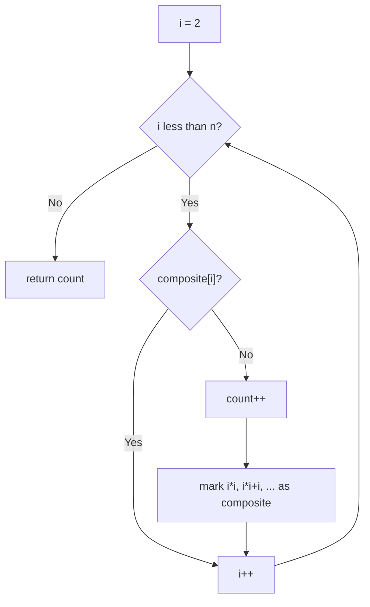

# 204. Count Primes

🟡 **Medium** · Math / Sieve · [Problem on LeetCode](https://leetcode.com/problems/count-primes/)

## 📝 Problem
Return the number of prime numbers **strictly less than** `n`.

## 🧠 Intuition
Checking each number individually is slow. Flip it around with the **Sieve of Eratosthenes**:
each time we find a prime `p`, **cross out every multiple** of `p`. Numbers that are never crossed out are prime.

Why start crossing at `p × p`? Smaller multiples like `2p`, `3p` were already crossed out by the smaller primes `2`, `3`, ….

## 🪜 Approach
**🐢 Brute force:** for each number test divisors up to `√k` → `O(n√n)`.

**⚡ Sieve:**
1. `composite[0..n-1] = false`.
2. For `i = 2 … n-1`:
   - if `!composite[i]` → `count++`, then mark `i*i, i*i+i, …` as composite.
3. Return `count`.

## 🔁 Flow

## 🔍 Dry run
`n = 10`
- 2 prime → cross 4, 6, 8
- 3 prime → cross 9
- 4 crossed · 5 prime · 6 crossed · 7 prime · 8, 9 crossed

Primes: 2, 3, 5, 7 → **4** ✅

## ⏱️ Complexity
| | |
|---|---|
| Time | `O(n log log n)` |
| Space | `O(n)` |

## 💡 Key takeaway
Many "count primes / smallest factor" problems → **sieve once**, then answer quickly. Use `long` for `i * i` to avoid overflow.
