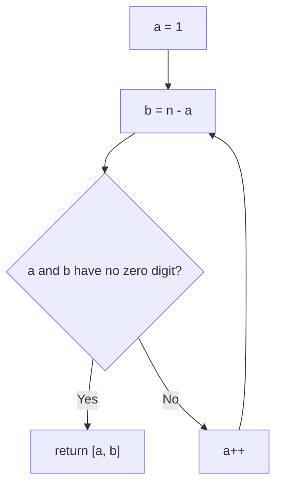

# 1317. Convert Integer to the Sum of Two No-Zero Integers

🟢 **Easy** · Math · [Problem on LeetCode](https://leetcode.com/problems/convert-integer-to-the-sum-of-two-no-zero-integers/)

## 📝 Problem
Return any two positive integers `[a, b]` with `a + b = n` such that **neither contains the digit 0**.

## 🧠 Intuition
Valid pairs are very common, so just **try** `a = 1, 2, 3, …` with `b = n − a` and return the first pair with no zero digits.

## 🪜 Approach
1. For `a = 1 … n-1`:
   - `b = n − a`
   - if `hasNoZero(a) && hasNoZero(b)` → return `[a, b]`
2. `hasNoZero` checks each digit with `% 10` and `/ 10`.

## 🔁 Flow

## 🔍 Dry run
`n = 11`
- a=1, b=10 → b has a 0 ❌
- a=2, b=9 ✅ → **[2, 9]**

## ⏱️ Complexity
| | |
|---|---|
| Time | `O(n log n)` worst case (digit checks), very fast in practice |
| Space | `O(1)` |

## 💡 Key takeaway
When valid answers are dense, a **simple search with a check function** is clean and fast enough.
