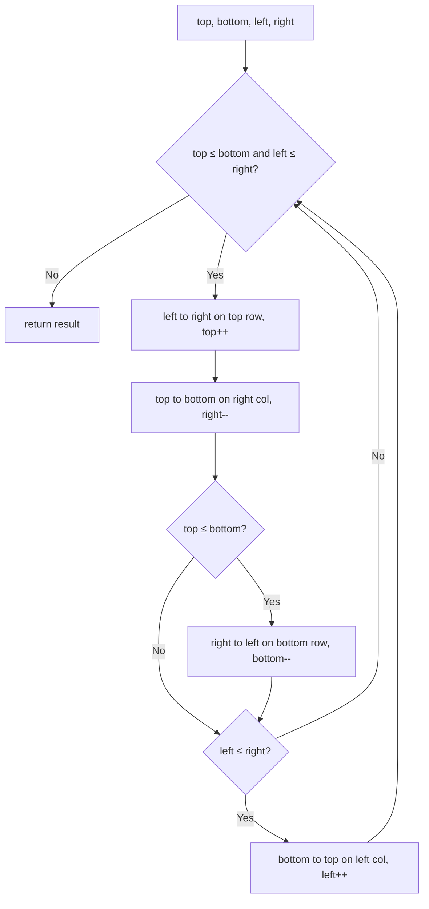

# 54. Spiral Matrix

🟡 **Medium** · Matrix / Simulation · [Problem on LeetCode](https://leetcode.com/problems/spiral-matrix/)

## 📝 Problem
Return all elements of an `m × n` matrix in **spiral order** (clockwise, from the top-left).

## 🧠 Intuition
Picture four walls closing in. Each lap:
1. → read the **top** row, then move `top` down
2. ↓ read the **right** column, then move `right` left
3. ← read the **bottom** row, then move `bottom` up
4. ↑ read the **left** column, then move `left` right

The `if` checks before steps 3 and 4 stop us from re-reading a row or column when the matrix is only one row or column thick.

## 🪜 Approach
1. `top = 0`, `bottom = m−1`, `left = 0`, `right = n−1`.
2. While `top ≤ bottom` and `left ≤ right`: do the 4 walks above.
3. Return the list.

## 🔁 Flow


## 🔍 Dry run
```
1 2 3
4 5 6
7 8 9
```
→ top `1 2 3` → right `6 9` → bottom `8 7` → left `4` → centre `5`
Answer: **[1,2,3,6,9,8,7,4,5]** ✅

## ⏱️ Complexity
| | |
|---|---|
| Time | `O(m · n)` |
| Space | `O(1)` extra |

## 💡 Key takeaway
Matrix traversal patterns → maintain **boundaries** and shrink them.
