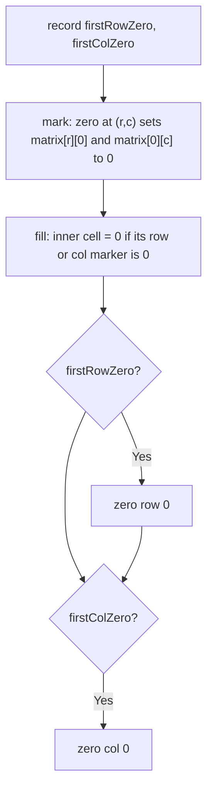

# 73. Set Matrix Zeroes

🟡 **Medium** · Matrix · [Problem on LeetCode](https://leetcode.com/problems/set-matrix-zeroes/)

## 📝 Problem
If a cell is `0`, set its **entire row and column** to `0`. Do it **in place**.

## 🧠 Intuition
If we zero things immediately, new zeros will wrongly trigger more zeroing. So first **record** which rows and columns need zeroing, then apply.
- Easy way: `boolean[] rows`, `boolean[] cols` → `O(m + n)` space.
- **O(1) trick:** the **first row** and **first column** can *be* those marker arrays. We just need two extra booleans to remember whether row 0 / col 0 originally had a zero.

## 🪜 Approach
1. Check if row 0 / col 0 contain a zero → `firstRowZero`, `firstColZero`.
2. For every inner cell `(r, c)` that is `0`: set `matrix[r][0] = 0` and `matrix[0][c] = 0`.
3. For every inner cell: if its row marker or col marker is `0` → set it to `0`.
4. Zero row 0 / col 0 if their flags are set (done **last** so the markers aren't destroyed early).

## 🔁 Flow


## 🔍 Dry run
```
1 1 1        1 0 1        1 0 1
1 0 1   →    0 0 1   →    0 0 0
1 1 1        1 1 1        1 0 1
           (markers)     (filled)
```
Answer ✅ `[[1,0,1],[0,0,0],[1,0,1]]`

## ⏱️ Complexity
| | |
|---|---|
| Time | `O(m · n)` |
| Space | `O(1)` |

## 💡 Key takeaway
To save space, **reuse part of the input as bookkeeping**, and be careful about the order you update things.
