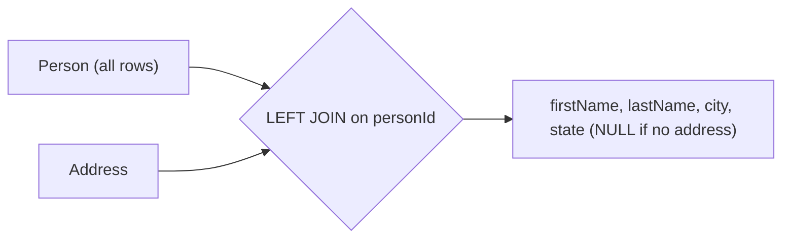

# 175. Combine Two Tables

🟢 **Easy** · SQL / Joins · [Problem on LeetCode](https://leetcode.com/problems/combine-two-tables/)

> ℹ️ This is a **database** problem. LeetCode only accepts SQL here, so the solution is in MySQL.

## 📝 Problem
Report `firstName, lastName, city, state` for **every** person in `Person`. If a person has no row in `Address`, show `null` for city and state.

## 🧠 Intuition
"Every row from table A, plus matching data from B if it exists" → **LEFT JOIN**.
An `INNER JOIN` would drop people without an address.

## 🪜 Approach
1. Start from `Person` (the table whose rows must all appear).
2. `LEFT JOIN Address` on `personId`.
3. Select the four columns.

## 🔁 Flow

## 🔍 Dry run
| Person | Address |
|---|---|
| 1 Wang Allen | 1 → (personId 2) New York City, New York |
| 2 Alice Bob | |

Result:
| firstName | lastName | city | state |
|---|---|---|---|
| Allen | Wang | null | null |
| Bob | Alice | New York City | New York |

## ⏱️ Complexity
| | |
|---|---|
| Time | `O(P + A)` with an index/hash join on `personId` |
| Space | Handled by the database engine |

## 💡 Key takeaway
**INNER JOIN** = only matches. **LEFT JOIN** = all rows from the left table, with NULLs where there's no match.
