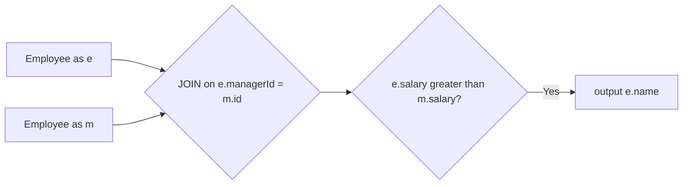

# 181. Employees Earning More Than Their Managers

🟢 **Easy** · SQL / Self Join · [Problem on LeetCode](https://leetcode.com/problems/employees-earning-more-than-their-managers/)

> ℹ️ Database problem. SQL (MySQL) solution.

## 📝 Problem
`Employee(id, name, salary, managerId)`. Return the names of employees who earn **more than their manager**.

## 🧠 Intuition
The manager is also a row in `Employee`. To compare an employee with their manager on one row, **join the table with itself**:
- alias `e` = the employee
- alias `m` = the manager, matched by `e.managerId = m.id`

Then filter `e.salary > m.salary`.

## 🪜 Approach
1. `Employee e JOIN Employee m ON e.managerId = m.id`.
2. `WHERE e.salary > m.salary`.
3. Select `e.name AS Employee`.

Employees with no manager (`managerId IS NULL`) are dropped automatically by the inner join.

## 🔁 Flow

## 🔍 Dry run
| id | name | salary | managerId |
|:-:|---|:-:|:-:|
| 1 | Joe | 70000 | 3 |
| 2 | Henry | 80000 | 4 |
| 3 | Sam | 60000 | null |
| 4 | Max | 90000 | null |

- Joe (70k) vs Sam (60k) ✅
- Henry (80k) vs Max (90k) ❌

Result: **Joe**

## ⏱️ Complexity
| | |
|---|---|
| Time | `O(n)` with an index on `id` |
| Space | Handled by the database engine |

## 💡 Key takeaway
Comparing rows of the **same** table → **self join** with two aliases.
