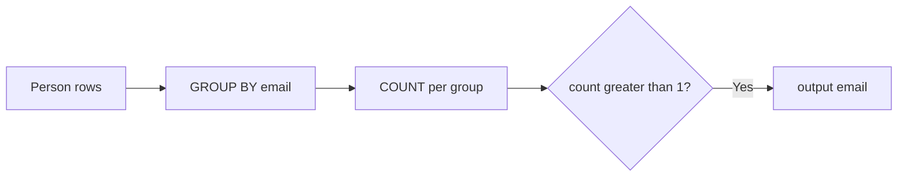

# 182. Duplicate Emails

🟢 **Easy** · SQL / Group By · [Problem on LeetCode](https://leetcode.com/problems/duplicate-emails/)

> ℹ️ Database problem. SQL (MySQL) solution.

## 📝 Problem
`Person(id, email)`. Report all emails that appear **more than once**.

## 🧠 Intuition
"How many times does each email appear?" → **GROUP BY email** and count.
We want to filter on the **count**, which only exists after grouping, so use **HAVING** (not `WHERE`).

## 🪜 Approach
1. `GROUP BY email`.
2. `HAVING COUNT(*) > 1`.
3. Select `email AS Email`.

## 🔁 Flow

## 🔍 Dry run
| id | email |
|:-:|---|
| 1 | a@b.com |
| 2 | c@d.com |
| 3 | a@b.com |

Groups: `a@b.com → 2` ✅, `c@d.com → 1` ❌ → **a@b.com**

## ⏱️ Complexity
| | |
|---|---|
| Time | `O(n)` hash grouping (or `O(n log n)` sort-based) |
| Space | `O(distinct emails)` |

## 💡 Key takeaway
**WHERE** filters rows *before* grouping; **HAVING** filters groups *after* aggregation.
