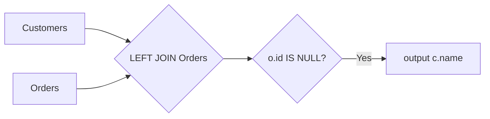

# 183. Customers Who Never Order

🟢 **Easy** · SQL / Anti Join · [Problem on LeetCode](https://leetcode.com/problems/customers-who-never-order/)

> ℹ️ Database problem. SQL (MySQL) solution.

## 📝 Problem
`Customers(id, name)` and `Orders(id, customerId)`. Return the customers who **never** placed an order.

## 🧠 Intuition
A **LEFT JOIN** keeps every customer. If a customer has no order, the `Orders` columns are `NULL`.
So "customers without a match" = `WHERE o.id IS NULL`. This pattern is called an **anti join**.

*(Alternative: `WHERE c.id NOT IN (SELECT customerId FROM Orders)`, but watch out for NULLs inside `NOT IN`.)*

## 🪜 Approach
1. `Customers c LEFT JOIN Orders o ON c.id = o.customerId`.
2. `WHERE o.id IS NULL`.
3. Select `c.name AS Customers`.

## 🔁 Flow

## 🔍 Dry run
Customers: `1 Joe, 2 Henry, 3 Sam, 4 Max` · Orders: `customerId 3, 1`
- Joe has an order · Henry ❌ none · Sam has an order · Max ❌ none

Result: **Henry, Max**

## ⏱️ Complexity
| | |
|---|---|
| Time | `O(C + O)` with a hash/index join |
| Space | Handled by the database engine |

## 💡 Key takeaway
"Rows in A with **no** match in B" → `LEFT JOIN … WHERE B.key IS NULL`.
