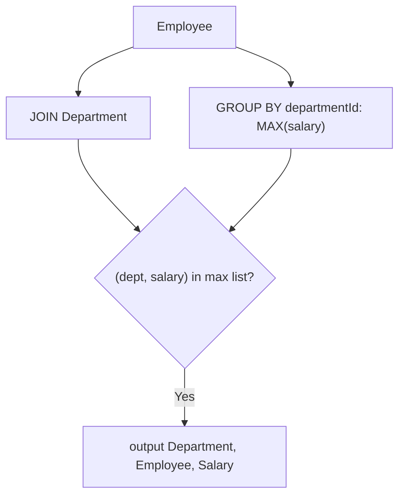

# 184. Department Highest Salary

🟡 **Medium** · SQL / Subquery / Group By · [Problem on LeetCode](https://leetcode.com/problems/department-highest-salary/)

> ℹ️ Database problem. SQL (MySQL) solution.

## 📝 Problem
`Employee(id, name, salary, departmentId)` and `Department(id, name)`. For each department, return the employee(s) with the **highest salary**. Ties are all included.

## 🧠 Intuition
Two steps:
1. **What is the top salary in each department?** → `SELECT departmentId, MAX(salary) … GROUP BY departmentId`
2. **Who earns exactly that?** → keep employees whose `(departmentId, salary)` pair is in that list.

Then join `Department` to show the department name.

*(Alternative: a window function, `RANK() OVER (PARTITION BY departmentId ORDER BY salary DESC) = 1`.)*

## 🪜 Approach
1. Subquery: max salary per department.
2. Outer query: `Employee JOIN Department`, filtered with `(departmentId, salary) IN (subquery)`.
3. Select `Department, Employee, Salary`.

## 🔁 Flow

## 🔍 Dry run
| name | salary | dept |
|---|:-:|---|
| Joe | 70000 | IT |
| Jim | 90000 | IT |
| Henry | 80000 | Sales |
| Sam | 60000 | Sales |
| Max | 90000 | IT |

Max per dept: IT → 90000, Sales → 80000

Result: **IT Jim 90000**, **IT Max 90000**, **Sales Henry 80000** (both IT ties kept ✅)

## ⏱️ Complexity
| | |
|---|---|
| Time | `O(n)` grouping + join (engine dependent) |
| Space | `O(departments)` for the subquery result |

## 💡 Key takeaway
"Top item per group, keep ties" → **compare with `MAX` per group** (or `RANK()` window function).
