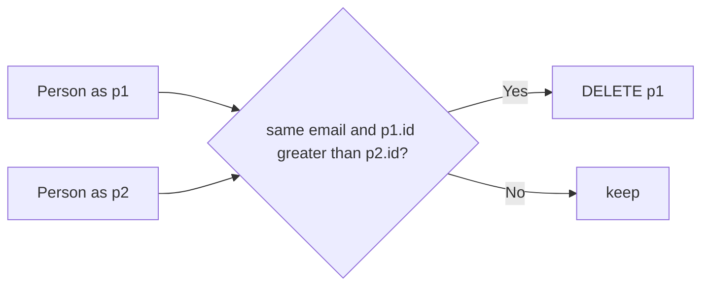

# 196. Delete Duplicate Emails

🟢 **Easy** · SQL / Self Join / DELETE · [Problem on LeetCode](https://leetcode.com/problems/delete-duplicate-emails/)

> ℹ️ Database problem. SQL (MySQL) solution. Note that this is a `DELETE` statement, not a `SELECT`.

## 📝 Problem
Delete duplicate emails from `Person(id, email)`, keeping only the row with the **smallest `id`** for each email.

## 🧠 Intuition
A row should be deleted if **another row has the same email and a smaller id**.
**Self join** `Person` with itself on equal email, where `p1.id > p2.id`. Every `p1` found that way is a duplicate to delete.

## 🪜 Approach
1. `Person p1 JOIN Person p2 ON p1.email = p2.email AND p1.id > p2.id`.
2. `DELETE p1` (MySQL lets you name which alias to delete from).

## 🔁 Flow

## 🔍 Dry run
| id | email |
|:-:|---|
| 1 | john@example.com |
| 2 | bob@example.com |
| 3 | john@example.com |

Pair `(p1 = 3, p2 = 1)`: same email and 3 > 1 → delete id 3.
Result: rows **1** and **2** remain ✅

## ⏱️ Complexity
| | |
|---|---|
| Time | Up to `O(n²)` pairs without an index, ~`O(n)` with an index on `email` |
| Space | Handled by the database engine |

## 💡 Key takeaway
"Delete all but one per group" → **self join with `id >`** to point at the extra copies.
