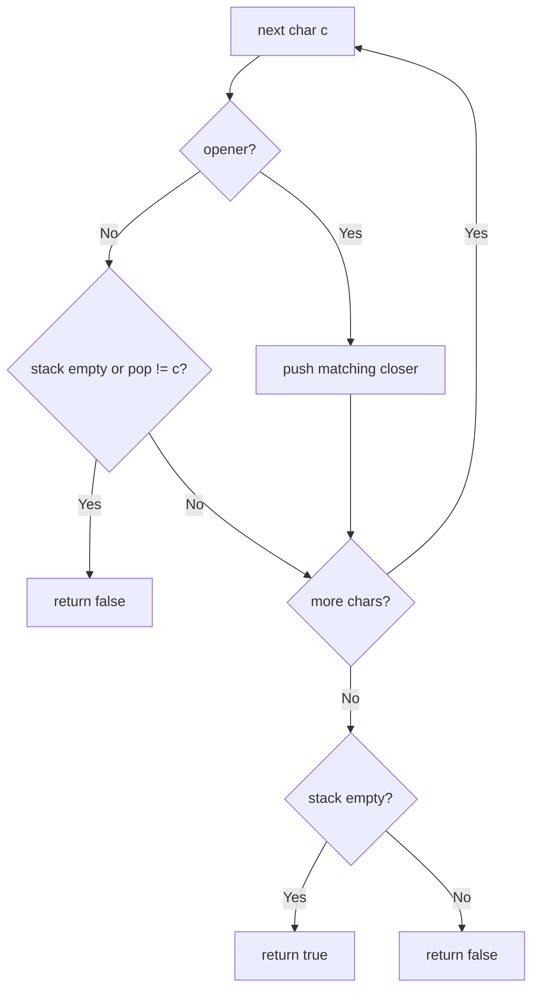

# 20. Valid Parentheses

🟢 **Easy** · Stacks · [Problem on LeetCode](https://leetcode.com/problems/valid-parentheses/)

## 📝 Problem
Given a string of `()[]{}`, decide if every bracket is closed by the **same type** and in the **correct order**.

## 🧠 Intuition
The **last** bracket opened must be the **first** one closed, which is LIFO, so use a **stack**.
Small trick: when we see an opener, push the **closer we expect**. Then a closing bracket simply has to equal `stack.pop()`.

## 🪜 Approach
1. For each char:
   - `(` / `{` / `[` → push `)` / `}` / `]`
   - closer → if the stack is empty or `pop() != c` → `false`
2. At the end, valid only if the stack is empty.

## 🔁 Flow

## 🔍 Dry run
`s = "({[]})"`
- `(` push `)` → `[)]`
- `{` push `}` → `[) }]`
- `[` push `]` → `[) } ]]`
- `]` pop `]` ✅ · `}` pop `}` ✅ · `)` pop `)` ✅ → empty → **true**

`s = "(]"` → push `)`, then `]` ≠ `)` → **false**

## ⏱️ Complexity
| | |
|---|---|
| Time | `O(n)` |
| Space | `O(n)` |

## 💡 Key takeaway
Matching / nesting problems → **stack**. Prefer `ArrayDeque` over the old `Stack` class in Java.
