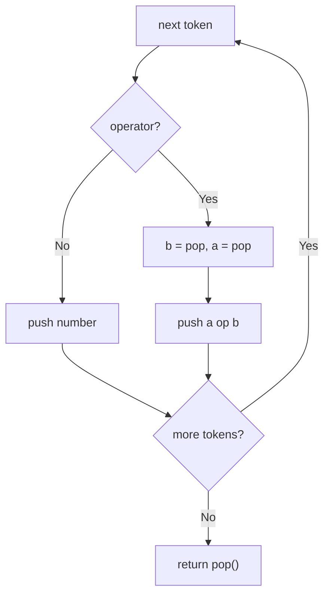

# 150. Evaluate Reverse Polish Notation

🟡 **Medium** · Stacks · [Problem on LeetCode](https://leetcode.com/problems/evaluate-reverse-polish-notation/)

## 📝 Problem
Evaluate an expression in **Reverse Polish Notation** (postfix), e.g. `["2","1","+","3","*"]` = `(2 + 1) * 3`. Division truncates toward zero.

## 🧠 Intuition
In postfix, an operator always works on the **two most recent values**. That's exactly what a stack gives us:
- number → push
- operator → pop two, compute, push the result

⚠️ For `-` and `/`, the **first pop is the right operand** (`b`), and the second is the left (`a`).

## 🪜 Approach
1. For each token:
   - `+ - * /` → `b = pop()`, `a = pop()`, push `a op b`
   - otherwise push `parseInt(token)`
2. Return the single value left on the stack.

## 🔁 Flow

## 🔍 Dry run
`["4","13","5","/","+"]`

| token | stack |
|:-:|---|
| 4 | [4] |
| 13 | [4, 13] |
| 5 | [4, 13, 5] |
| / | 13 / 5 = 2 → [4, 2] |
| + | 4 + 2 = 6 → [6] |

Answer: **6** ✅

## ⏱️ Complexity
| | |
|---|---|
| Time | `O(n)` |
| Space | `O(n)` |

## 💡 Key takeaway
Postfix evaluation = **stack of operands**. Watch the operand order for non-commutative ops.
