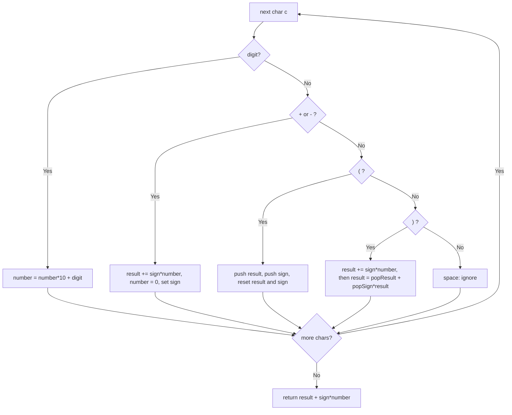

# 224. Basic Calculator

🔴 **Hard** · Stacks / Math · [Problem on LeetCode](https://leetcode.com/problems/basic-calculator/)

## 📝 Problem
Evaluate a string expression containing non-negative integers, `+`, `-`, `(`, `)` and spaces. Unary minus may appear (e.g. `-(2+3)`). Don't use `eval`.

## 🧠 Intuition
With only `+` and `-`, any expression is just a **sum of signed numbers**:
`1 - (2 + 3)` = `1 - 2 - 3`.

Keep a running `result`, the current `sign`, and the `number` being read.
- On `(`, the current state is "paused": push `result` and `sign` onto a stack and evaluate the inside from scratch.
- On `)`, pop them back: `result = savedResult + savedSign × insideResult`.

## 🪜 Approach
1. `result = 0`, `number = 0`, `sign = 1`.
2. For each char:
   - **digit** → `number = number*10 + digit`
   - **`+` / `-`** → `result += sign*number`; reset `number`; set `sign`
   - **`(`** → push `result`, push `sign`; reset `result = 0`, `sign = 1`
   - **`)`** → `result += sign*number`; `number = 0`; `result = pop_result + pop_sign × result`
3. Return `result + sign*number`.

## 🔁 Flow

## 🔍 Dry run
`s = "1 - (2 + 3)"`

| char | action | result | sign | stack |
|:-:|---|:-:|:-:|---|
| 1 | number = 1 | 0 | +1 | [] |
| - | result = 1, sign = −1 | 1 | −1 | [] |
| ( | push 1, push −1, reset | 0 | +1 | [1, −1] |
| 2 | number = 2 | 0 | +1 | |
| + | result = 2 | 2 | +1 | |
| 3 | number = 3 | 2 | +1 | |
| ) | result = 5 → 1 + (−1)(5) | **−4** | | [] |

Answer: **−4** ✅

## ⏱️ Complexity
| | |
|---|---|
| Time | `O(n)` |
| Space | `O(n)` for nested parentheses |

## 💡 Key takeaway
Parentheses = **save state on a stack, solve the inside, restore and combine**.
